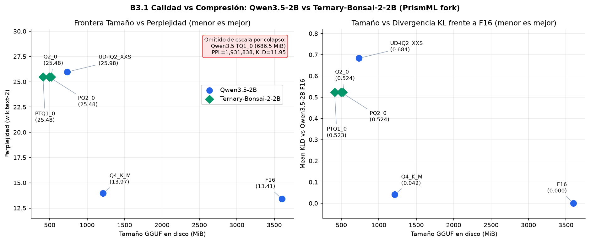
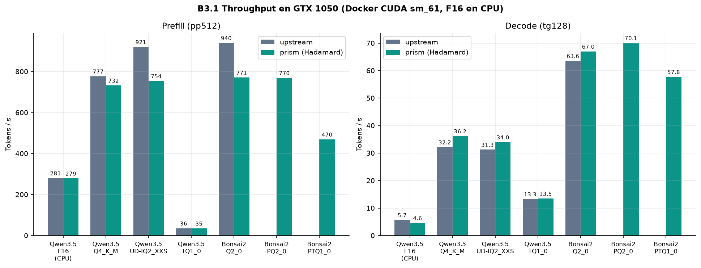
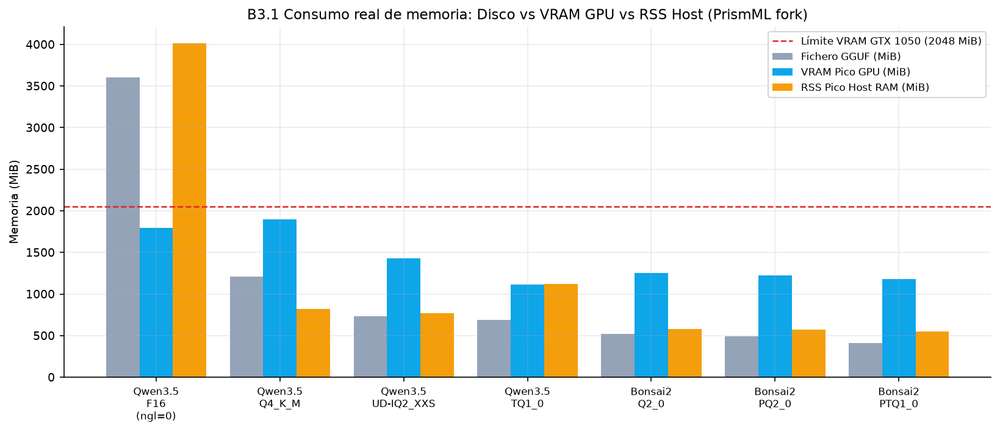
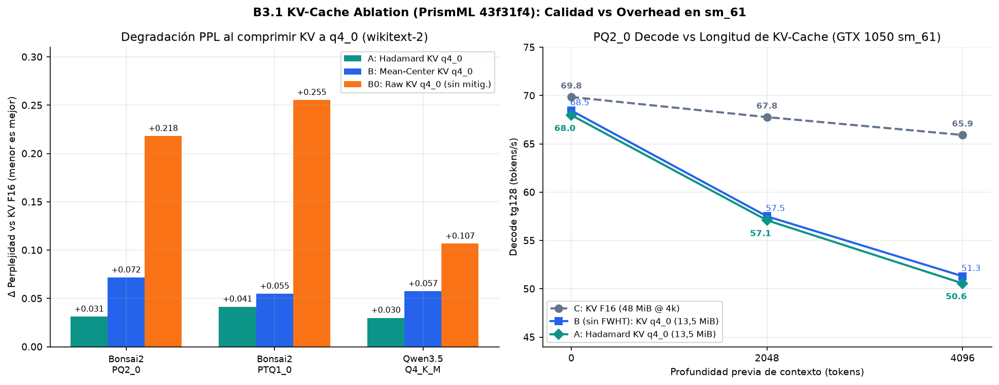
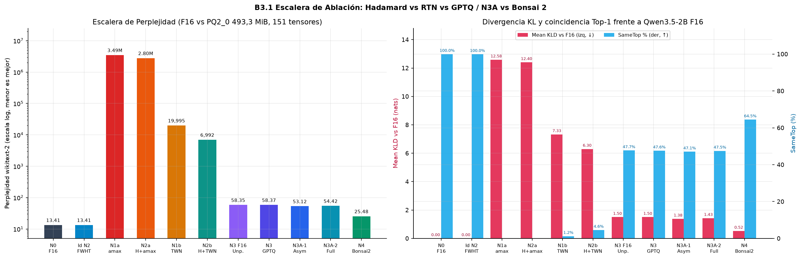

# B3.1b — Cuantización extrema con Hadamard: Qwen3.5-2B vs Ternary-Bonsai-2-2B (`llama.cpp` en Docker)

Práctica local de cuantización sub-4-bit y ternaria ($\{-1, 0, +1\}$) sobre una **NVIDIA GeForce GTX 1050 (`sm_61`, 2 GB VRAM)** ejecutada **100 % dentro de Docker** (compilación CUDA 12.6, `llama-bench`, `llama-perplexity`, `llama-cli` y `llama-kv-mean-center`), con pesos descargados offline en `D:` y script acompañante para **Android Termux** (CPU NEON / Vulkan + medición real de energía en `mWh/token`).

> **Resultados verificados:** Todas las cifras y gráficas de esta página proceden de ejecuciones reales en contenedor CUDA `sm_61` sobre GTX 1050 (`driver 581.57`), almacenadas en [`artifacts/b3_1_results.json`](../artifacts/b3_1_results.json) y [`artifacts/b3_1_kv_ablation.json`](../artifacts/b3_1_kv_ablation.json).

---

## 1. Comparativa técnica: forks de `llama.cpp` con transformación de Hadamard

Existen cuatro implementaciones relevantes en el ecosistema `llama.cpp` que incorporan rotaciones de Hadamard (Fast Walsh-Hadamard Transform, FWHT):

| Repositorio / Rama | Qué rota con Hadamard | Formatos / mecanismos clave | Soporte Pascal (`sm_61`) | Cuándo usarlo |
| :--- | :--- | :--- | :---: | :--- |
| **`ggml-org/llama.cpp`** (`master`, rev `ca123ba`) | Activaciones/pesos `prism.hadamard` (`Q2_0`), más rotación FWHT automática de KV-cache (PR #21038) | `Q2_0` (group-64), `TQ1_0`, `UD-IQ2_XXS`, `Q4_K_M`, `F16` | ✅ CUDA 12.6 (`-DCMAKE_CUDA_ARCHITECTURES=61`) | Referencia upstream estándar y base de `Q2_0` |
| **`PrismML-Eng/llama.cpp`** (rama `prism`, rev `43f31f4`) | Contrato completo **`prism.hadamard` v1/v2** (incluido `hadamard-tied-output`), rotación Hadamard KV (`n_rot_k`/`n_rot_v`) y calibrador `--kv-mean-center` (PRs #53/#54) | **`PQ2_0`** (group-128), **`PTQ1_0`** (~1,83 bpw, `mmvq-ptq1_0.cuh`), `Q2_0` y formatos estándar | ✅ CUDA 12.6 (`sm_61`; `PTQ1_0` usa ruta MMVQ $\le 8$ cols) | Obligatorio para **`PQ2_0`**, **`PTQ1_0`** y comparativa A/B de KV |
| **`TheTom/llama-cpp-turboquant`** (`feature/turboquant-kv-cache`) | KV-Cache en tiempo de ejecución (FWHT 128×128 + PolarQuant/Lloyd-Max) | `--cache-type-k / -v turbo2_0..4_0` | ⚠️ Kernels `fattn-mma-turbo` orientados a Ampere+ | Comprimir KV en contextos largos (no soporta `PQ2_0`/`PTQ1_0`) |
| **`ikawrakow/ik_llama.cpp`** (`main`) | Kernels `hadamard.cu` propios y cuantizaciones IQK/trellis (`tq2_t`) | Formatos IQK propios, MLA, MoE offload | ⚠️ Caída parcial de FlashAttention en Pascal/Volta | CPU AVX-512 / MoE en CUDA moderno (sin `PQ2_0`/`PTQ1_0`) |

### Por qué funciona la rotación de Hadamard en pesos ternarios

Los pesos y activaciones de un Transformer presentan *outliers* por canal que destruyen la relación señal/cuantización al bajar a 1,58–2 bits. Multiplicar por una matriz ortogonal de Walsh-Hadamard normalizada $H$ ($H^\top H = I$, computable en $O(d \log d)$ mediante mariposas suma/resta en `fwht.cu`) redistribuye la energía de los *outliers* de forma cuasi-gaussiana:

$$y = W x = (W H^\top)(H x)$$

- En **Ternary-Bonsai-2-2B**, la rotación por bloques (tamaño 512 con vector explícito de signos en `prism.hadamard.*`) y el QAT pliegan $W H^\top$ en el GGUF ternario $\{-1, 0, +1\}$.
- Gracias a **`prism.hadamard.tied_output = true`** y `inverse_weight_names = ["token_embd.weight"]`, la rotación se aplica también de forma coherente sobre la proyección de salida compartida (*tied LM head* de 248.320 tokens) sin expandir los pesos a FP16.

---

## 2. Benchmark completo: `Qwen3.5-2B` vs `Ternary-Bonsai-2-2B` (`sm_61`)

Entorno medido en contenedor `ai-infra-study:llama-cuda12.6` sobre **NVIDIA GeForce GTX 1050 (`2048 MiB`, `sm_61`, driver `581.57`)**:

- **Motores compilados:** `upstream` (`ggml-org/llama.cpp` `ca123ba`) y `prism` (`PrismML-Eng/llama.cpp` `43f31f4`).
- **Configuración:** `-lm none` (evita el bloqueo de `mmap` en estado `Dsl` sobre montaje `9p` de Docker Desktop WSL2), `-fa on` (`1` en `llama-bench`), `pp512`/`tg128` con `reps=3`, PPL y KLD frente a `Qwen3.5-2B F16` sobre `wikitext-2-raw/wiki.test.raw` (`n_ctx=512`, `8 chunks` = 4096 tokens).

| Modelo | Quant | Tamaño (MiB) | Motor | NGL | pp512 (tok/s) | tg128 (tok/s) | RSS Pico (MiB) | VRAM Pico (MiB) | PPL | Mean KLD | SameTop (%) |
| :--- | :--- | ---: | :--- | ---: | ---: | ---: | ---: | ---: | ---: | ---: | ---: |
| Qwen3.5-2B | `F16` | 3600,8 | `upstream` | 0 | 281,11 | 5,69 | 4017,4 | 1779,0 | 13,4057 | 0,0000 | 100,00 |
| Qwen3.5-2B | `F16` | 3600,8 | `prism` | 0 | 279,01 | 4,63 | 4010,2 | 1797,0 | 13,4057 | 0,0000 | 100,00 |
| Qwen3.5-2B | `Q4_K_M` | 1211,9 | `upstream` | 99 | 777,23 | 32,21 | 818,4 | 1919,0 | 13,9424 | 0,0389 | 89,22 |
| Qwen3.5-2B | `Q4_K_M` | 1211,9 | `prism` | 99 | 732,29 | 36,21 | 819,5 | 1899,0 | 13,9723 | 0,0421 | 89,36 |
| Qwen3.5-2B | `UD-IQ2_XXS` | 732,7 | `upstream` | 99 | 920,71 | 31,27 | 771,1 | 1430,0 | 26,0097 | 0,6826 | 58,14 |
| Qwen3.5-2B | `UD-IQ2_XXS` | 732,7 | `prism` | 99 | 754,23 | 34,00 | 768,0 | 1430,0 | 25,9786 | 0,6836 | 58,53 |
| Qwen3.5-2B | `TQ1_0` | 686,5 | `upstream` | 99 | 35,93 | 13,30 | 1108,8 | 1106,0 | 1.954.351 | 11,9470 | 0,00 |
| Qwen3.5-2B | `TQ1_0` | 686,5 | `prism` | 99 | 35,18 | 13,47 | 1124,4 | 1114,0 | 1.931.838 | 11,9529 | 0,05 |
| Ternary-Bonsai-2-2B | `Q2_0` | 521,4 | `upstream` | 99 | 940,14 | 63,60 | 580,1 | 1253,0 | 25,4856 | 0,5237 | 64,66 |
| Ternary-Bonsai-2-2B | `Q2_0` | 521,4 | `prism` | 99 | 771,06 | 67,00 | 577,7 | 1253,0 | 25,4773 | 0,5238 | 64,46 |
| Ternary-Bonsai-2-2B | `PQ2_0` | 493,3 | `prism` | 99 | 769,51 | **70,10** | 569,8 | 1226,0 | 25,4773 | 0,5238 | 64,46 |
| Ternary-Bonsai-2-2B | `PTQ1_0` | **409,3** | `prism` | 99 | 469,56 | 57,77 | **547,0** | **1180,0** | 25,4808 | **0,5233** | **64,80** |







### Explicación técnica de los hallazgos

1. **Colapso de `TQ1_0` sin Hadamard frente a preservación con `Ternary-Bonsai-2-2B`:**
   `Qwen3.5-2B-TQ1_0` (`686,5 MiB`) destruye la distribución de salida (`PPL ~ 1,93M`, `KLD = 11,95`, `SameTop ~ 0 %`) por saturación de pesos/activaciones al cuantizar a ~1,69 bpw sin rotación ni entrenamiento consciente de cuantización (QAT). En cambio, **`Ternary-Bonsai-2-2B`** logra `PPL = 25,48`, `KLD = 0,523` y `SameTop = 64,5–64,8 %` en `409–521 MiB` gracias a QAT + rotación Hadamard de bloque + soporte `hadamard-tied-output`.
2. **Frontera Pareto frente a 2-bit no rotado (`UD-IQ2_XXS`):**
   Comparado contra `Qwen3.5-2B-UD-IQ2_XXS` (`732,7 MiB`), **`Bonsai-2 PQ2_0` (`493,3 MiB`)** ocupa un **32,7 % menos en disco**, reduce el **KLD de `0,684` a `0,524`** (mejora `+6,0 pp` en `SameTop`) y alcanza **`70,10 tok/s` frente a `34,00 tok/s` en decode (`2,06×`)**.
3. **Por qué `PQ2_0` supera a `PTQ1_0` en Pascal `sm_61` y por qué `PTQ1_0` usa `-b 8 -ub 8` en perplexity:**
   En el código fuente de `PrismML-Eng/llama.cpp` (`ggml/src/ggml-cuda/mmq.cu`), el kernel **MMQ** de `GGML_TYPE_PTQ1_0` exige instrucciones MMA de **Turing o superior** (`turing_mma_available(cc)`, `sm_75+`). En Pascal (`sm_61`), solo se compila el kernel vectorizado **`mmvq-ptq1_0.cuh`** con techo **`PTQ1_0_PT_MAX_COLS = 8`**:
   - Para lotes de evaluación `> 8` (como `llama-perplexity -b 128` calculando logits sobre `[128, 248320]`), el scheduler retrocede a desquantización `F16` + cuBLAS sobre la matriz de salida compartida (`~969 MiB`), agotando los 2 GB de VRAM (`cuMemSetAccess` OOM).
   - Al fijar **`-b 8 -ub 8`** en `PTQ1_0`, todo el cálculo permanece en `mmvq-ptq1_0.cuh` (VRAM pico en perplexity: `640 MiB`, `PPL = 25,4808`). En prefill/decode (`pp512`), esa ausencia de MMQ explica por qué `PQ2_0` (`769,5` / `70,1 tok/s`) es más rápido que `PTQ1_0` (`469,6` / `57,8 tok/s`) en GTX 1050, pese a que `PTQ1_0` pesa un 17 % menos en disco. En GPUs `sm_75+` (L4/L40S/H100), `PTQ1_0` sí dispara MMQ.
4. **Diferencias `upstream` (`ca123ba`) vs `prism` (`43f31f4`):**
   `upstream` logra mayor `pp512` (`940,1` vs `771,1 tok/s` en `Q2_0`; `920,7` vs `754,2 tok/s` en `IQ2_XXS`), mientras `prism` aventaja en decode `tg128` (`67,0` vs `63,6 tok/s` en `Q2_0`; `36,2` vs `32,2 tok/s` en `Q4_K_M`) además de aportar `PQ2_0`, `PTQ1_0`, rotación KV Hadamard y `--kv-mean-center`.
5. **Huella real de memoria y VRAM del baseline CPU (`F16`):**
   Aunque `Qwen3.5-2B F16` corre con `-ngl 0` en CPU (`4017 MiB` RSS host, `4,6–5,7 tok/s`), CUDA reserva igualmente `1779–1855 MiB` en GPU para buffers de cómputo/activaciones cuando el backend CUDA está activo. Por el contrario, `PQ2_0` y `PTQ1_0` dejan más de `750–850 MiB` libres en GTX 1050 y consumen `< 570 MiB` de RAM host.

---

## 3. Verificación de KV-cache en `43f31f4` y experimento A/B/C

Se verificó directamente sobre los binarios compilados de **`PrismML-Eng/llama.cpp` (`43f31f4`)** en GTX 1050 (`sm_61`):

1. **Rotación Hadamard de KV activa por defecto (`-fa on -ctk q4_0 -ctv q4_0` en `-c 4096`):**
   Los logs de ejecución de `llama-cli --verbose` confirman que la rotación se activa en las **6 capas de atención completa** del híbrido Qwen3.5 (capas 3, 7, 11, 15, 19, 23; las otras 18 son capas recurrentes GatedDeltaNet) mediante grafos `attn_inp_k_rot` (`256×256`) y `attn_inp_v_rot` (`64×64`):
   - `llama_kv_cache: size = 13.50 MiB (4096 cells, 6 layers, 1/1 seqs), K (q4_0): 6.75 MiB, V (q4_0): 6.75 MiB` (frente a `48,00 MiB` en `f16`)
   - `llama_kv_cache: n_rot_k = 256, n_embd_head_k_all = 256` y `llama_kv_cache: n_rot_v = 64`
2. **Calibrador `--kv-mean-center` y guarda de seguridad del PR #53:**
   - Calibración con `llama-kv-mean-center` sobre split de cola no solapado de `wiki.test.raw` (`--chunks 16`, `-c 512`) escribe el sesgo de 6 capas (`12,67 KiB`) anotando `(measured with K rotation inactive)`.
   - Al intentar cargar dicho fichero con `llama-cli --kv-mean-center` **sin** `LLAMA_ATTN_ROT_DISABLE=1`, la guarda del PR #53 rechaza arrancar (`rc = 1`):
     `load_kv_mean_center: bias file ... was calibrated with the K-cache rotation inactive, but it is active for this context`.
   - Con `LLAMA_ATTN_ROT_DISABLE=1`, desactiva la rotación (`n_rot_k = 0, n_rot_v = 0`), carga el sesgo (`loaded K-cache mean-centering bias for 6 / 6 layer(s)`) y genera salida coherente (`rc = 0`).

### Tabla comparativa A / B / B0 / C (`wikitext-2` 8 chunks + `llama-bench` `sm_61`)

| Modelo | Modo | Config KV | PPL | Δ PPL vs F16 | Mean KLD | SameTop (%) | `tg128` `d=0` | `tg128` `d=2048` | `tg128` `d=4096` | VRAM Pico `bench` |
| :--- | :--- | :--- | ---: | ---: | ---: | ---: | ---: | ---: | ---: | ---: |
| `Bonsai2 PQ2_0` | **A. Hadamard KV** | `q4_0`, `n_rot=256/64` | 25,5083 | **+0,0311** | **0,5265** | 64,46 | 67,97 | 57,09 | 50,56 | 1278 MiB |
| `Bonsai2 PQ2_0` | **B. Mean-Center KV** | `q4_0`, `ROT_DISABLE=1` + bias | 25,5489 | +0,0716 | 0,5272 | 64,41 | 68,45 *(sin rot)* | 57,50 *(sin rot)* | 51,30 *(sin rot)* | 1278 MiB |
| `Bonsai2 PQ2_0` | **B0. Raw Q4_0** | `q4_0`, `ROT_DISABLE=1` sin bias | 25,6953 | +0,2181 | 0,5295 | 64,76 | — | — | — | — |
| `Bonsai2 PQ2_0` | **C. Control F16** | `f16` sin rotación | **25,4773** | 0,0000 | **0,5238** | 64,46 | **69,85** | **67,77** | **65,92** | 1316 MiB |
| `Bonsai2 PTQ1_0` | **A. Hadamard KV** | `q4_0`, `n_rot=256/64` | 25,5223 | **+0,0415** | **0,5266** | 64,56 | 56,85 | 49,10 | — | 1224 MiB |
| `Bonsai2 PTQ1_0` | **B. Mean-Center KV** | `q4_0`, `ROT_DISABLE=1` + bias | 25,5357 | +0,0549 | 0,5273 | 64,61 | 57,31 *(sin rot)* | 49,60 *(sin rot)* | — | 1224 MiB |
| `Bonsai2 PTQ1_0` | **B0. Raw Q4_0** | `q4_0`, `ROT_DISABLE=1` sin bias | 25,7362 | +0,2554 | 0,5289 | 65,39 | — | — | — | — |
| `Bonsai2 PTQ1_0` | **C. Control F16** | `f16` sin rotación | **25,4808** | 0,0000 | **0,5233** | 64,80 | **57,83** | **56,32** | — | 1250 MiB |
| `Qwen3.5 Q4_K_M` | **A. Hadamard KV** | `q4_0`, `n_rot=256/64` | 14,0023 | **+0,0299** | **0,0478** | **88,48** | 35,89 | 34,67 *(d=1024)* | — | 1910 MiB |
| `Qwen3.5 Q4_K_M` | **B. Mean-Center KV** | `q4_0`, `ROT_DISABLE=1` + bias | 14,0298 | +0,0574 | 0,0499 | 87,99 | 35,93 *(sin rot)* | 34,87 *(d=1024)* | — | 1871 MiB |
| `Qwen3.5 Q4_K_M` | **B0. Raw Q4_0** | `q4_0`, `ROT_DISABLE=1` sin bias | 14,0790 | +0,1067 | 0,0501 | 87,84 | — | — | — | — |
| `Qwen3.5 Q4_K_M` | **C. Control F16** | `f16` sin rotación | **13,9723** | 0,0000 | **0,0421** | **89,36** | **36,21** | **35,52** *(d=1024)* | — | 1883 MiB |

> **Nota de medición `llama-bench` vs `llama-cli`:** `llama-bench` no dispone del flag `--kv-mean-center`, por lo que su fila `B_norot` mide la velocidad de `q4_0` sin FWHT; la medición *end-to-end* de `llama-cli` con `--kv-mean-center` cargado sobre `PQ2_0` (128 tokens generados, `-c 4096`) confirmó **`59,4 tok/s` (Modo B)** frente a **`61,9 tok/s` (Modo A)** y **`67,0 tok/s` (Modo C `f16`)**. En la sonda de contexto largo (**#21383**) con **3611 tokens de prompt** dentro de `-c 4096`, tanto **Modo A (`n_rot_k=256, n_rot_v=64`, `51,0 tok/s`)** como **Modo B (`52,6 tok/s`)** completaron sin error CUDA (`rc = 0`, `0` reasignaciones de grafo); con prompts mayores que `-c 512` (660 tokens), `llama-cli` rechaza la petición limpiamente antes de hacer KV-shift.



### Lectura técnica de la comparativa KV-cache

1. **A (Hadamard KV) supera sistemáticamente a B (Mean-Center KV) y ambos aplastan a `Q4_0` sin mitigar (`B0`):**
   Sin mitigación (`B0`), cuantizar KV a `q4_0` añade `+0,22` a `+0,26` de PPL en Bonsai (`25,48 → 25,70–25,74`). **Hadamard KV (`A`)** reduce ese salto en un **84–86 %** (`+0,031` PPL en `PQ2_0`, `+0,041` en `PTQ1_0`, `+0,030` en `Q4_K_M`) sin necesitar corpus ni archivo externo de calibración. **Mean-Center (`B`)** recupera algo menos (`~67–79 %`, `+0,055–0,072` PPL), porque corregir solo la media por canal en K no suprime los *outliers* de varianza ni rota el tensor V.
2. **El coste de FWHT en KV es mínimo (`~0,4–0,7 tok/s`), pero `KV q4_0` es más lento que `KV F16` en Pascal `sm_61`:**
   - Aislando únicamente la rotación (`A` vs `B_norot` en `llama-bench` sobre `PQ2_0`), la FWHT cuesta solo **`0,48 tok/s` en `d=0`**, **`0,41 tok/s` en `d=2048`** y **`0,74 tok/s` en `d=4096`** (`~1 %`).
   - Sin embargo, **`F16` supera a `q4_0` en decode a medida que crece el contexto (`65,92` vs `50,56 tok/s` en `d=4096`, un `+30 %` más rápido)**. Razón arquitectónica y de hardware: Qwen3.5/Bonsai es un híbrido donde solo **6 de 24 capas** mantienen KV-cache, de modo que 4096 tokens en `F16` son apenas **48 MiB** (`13,5 MiB` en `q4_0`). En una GTX 1050 sin Tensor Cores ni DP4A especializado para FlashAttention cuantizado, el coste ALU por hilo de desquantizar bloques `q4_0` en atención supera el pequeño ahorro de ancho de banda de esos 34,5 MiB.
   - Conclusión práctica para `sm_61`: usa **Modo C (`KV F16`)** por defecto en `PQ2_0` cuando tengas margen de VRAM (`<= 4k` tokens); reserva **Modo A (`Hadamard KV q4_0`)** cuando busques **máxima ventana de contexto** o al ejecutar **`Q4_K_M` cerca del tope de 2 GB**.

---

## 4. Escalera de ablación Hadamard: `N0 → N1 → N2 → N3 → N4` en `PQ2_0`

Para aislar cuánto aporta **únicamente** la transformación Hadamard frente a la proyección RTN, a la compensación por Hessiano sin entrenamiento (**GPTQ**, `N3`) y al post-entrenamiento QAT de Bonsai 2 (`N4`), se evaluó el mismo modelo base (`Qwen3.5-2B-F16.gguf`) en `F16` sin empaquetar y empaquetado exactamente en **`PQ2_0` (`493,3 MiB`, `151 PQ2_0 + 169 F32`, `KV f16`)** mediante `make_bonsai_ablation.py`, `gptq_ternary.py` y `run_ablation_ladder.py`:

### 4.1 Test de Identidad en `F16` (verificación matemática antes de cuantizar)

Antes de cuantizar un solo peso, se verificó en `PrismML-Eng/llama.cpp` (`43f31f4`, `ngl=0`, `8 chunks` de `wiki.test.raw`) que inyectar `prism.hadamard.*` deja intacta la función del modelo:

| Modelo F16 | Contrato `prism.hadamard` | PPL | Mean KLD vs F16 | SameTop (%) |
| :--- | :--- | ---: | ---: | ---: |
| `Qwen3.5-2B F16` (base) | Sin cabecera | 13,4057 | 0,000000 | 100,000 |
| `F16 N1` (control identidad) | `v2`, `tied_output=true`, `block_size=1`, `sign_mode=identity` | 13,4057 | -0,000000 | 100,000 |
| `F16 N2` (Hadamard doblada) | `v2`, `tied_output=true`, `block_size=512`, `sign_mode=explicit` (151 tensores rotados) | **13,4055** | **0,000000** | **99,951** |

### 4.2 Resultados medidos `N1 → N2 → N3 → N4` (`GTX 1050`, `8 chunks × 512`)

Al cuantizar con `llama-quantize PQ2_0 --output-tensor-type pq2_0 --token-embedding-type pq2_0 --tensor-type ssm_alpha=f32 --tensor-type ssm_beta=f32`, todos los escalones ternarios empaquetados comparten exactamente los mismos `151 PQ2_0 + 169 F32` tensores (`493,3 MiB`):

| Nivel | Variante | Tamaño (MiB) | `pp512` (tok/s) | `tg128` (tok/s) | PPL (`8 chunks`) | Mean KLD | SameTop (%) | Lectura |
| :--- | :--- | ---: | ---: | ---: | ---: | ---: | ---: | :--- |
| **N0** | `Qwen3.5-2B F16` (techo) | 3600,8 | 279,01 | 4,63 | **13,41** | 0,0000 | 100,00 | Referencia superior sin pérdida |
| **N1a** | `N1` sin Hadamard (`d = amax` nativo `PQ2_0`) | 493,3 | 660,28 | 68,72 | 3.494.603 | 12,5837 | 0,00 | `d=amax` deja ~90 % de ceros; colapso total |
| **N2a** | `N2` con Hadamard (`d = amax` nativo `PQ2_0`) | 493,3 | 779,23 | 69,50 | 2.797.352 | 12,4026 | 0,00 | Hadamard sola **no basta** con `d=amax` sin calibrar |
| **N1b** | `N1` sin Hadamard + **TWN** MSE-óptimo (`g128`) | 493,3 | 652,98 | 67,88 | 19.995 | 7,3286 | 1,23 | Proyección óptima por bloque baja PPL `175×`, pero los *outliers* siguen dominando |
| **N2b** | `N2` **con Hadamard** + **TWN** MSE-óptimo (`g128`) | 493,3 | 779,09 | 69,94 | 6.992 | 6,3001 | 4,56 | Hadamard aplana *outliers* (**2,86× menos PPL**, **3,7× SameTop** frente a `N1b`) |
| **N3 (F16)** | `Hadamard + GPTQ` en **F16 sin empaquetar** (`ngl=0`) | 3600,8 | 237,43 | 4,64 | **58,35** | **1,5029** | **47,75** | Baseline F16 con pesos GPTQ ternarios sin empaquetado de bits (`15×` más lento que GPU `PQ2_0`) |
| **N3 (PQ2_0)** | `Hadamard + GPTQ` en **`PQ2_0`** (`ngl=99`) | 493,3 | **781,11** | **69,58** | **58,37** | **1,5032** | **47,60** | GPTQ recorta PPL **`120×`** frente a `N2b` (`6.992 → 58,37`) con pérdida casi nula al empaquetar (`+0,023` PPL) |
| **N3 (`embd Q6_K`)** | Igual que `N3`, re-empaquetando `token_embd` GPTQ en `Q6_K` (`ngl=99`) | 762,4 | 776,04 | 50,22 | 58,44 | 1,5039 | 47,70 | Verifica que `PQ2_0` en el embedding ya ternarizado no pierde calidad y evita penalizar `tg128` |
| **N3A-1 (`PQ2_0`)** | `token_embd` primero (`0,08`) + ridge asimétrico + `256c` (`60/40` chat) | 493,3 | 775,63 | **70,37** | **53,12** | **1,3776** | 47,06 | Baja **`-5,25` PPL** (`-18,2 %` mediana KLD: `1,019 → 0,833`) y elimina **`6/10 → 0/10`** EOS vacíos |
| **N3A-2 (`PQ2_0`)** | `N3A-1` + `--actorder` + $\alpha^*$ ponderado + WLS global `fp16` | 493,3 | 774,61 | 70,17 | 54,42 | 1,4286 | **47,50** | Clava JSON exacto en `json_gpu_spec` (`[End thinking]`); `static-groups` cede `+1,30` PPL frente a `N3A-1` dinámico |
| **N4** | `Ternary-Bonsai-2-2B PQ2_0` (PrismML) | 493,3 | 769,51 | **70,10** | **25,48** | **0,5238** | **64,46** | Receta Caltech + post-entrenamiento TPU (cierra el hueco `53,12 → 25,48` y recupera `10/10` en chat) |



### 4.3 Qué demuestra `N3` (GPTQ puro) y el duelo determinista de 10 prompts

1. **Por qué `d = amax` colapsa y qué aporta `TWN` (`N1 → N2`):** en `PrismML-Eng/llama.cpp` (`ggml/src/ggml-quants.c`, `quantize_row_pq2_0_ref`), `PQ2_0` fija la escala de cada bloque de 128 pesos a **`d = amax`**, anulando ~90 % de los pesos y provocando colapso tanto en `N1a` (`3,49M`) como en `N2a` (`2,80M`). Al pre-proyectar cada bloque a la retícula ternaria de mínimo error cuadrático (**TWN**, $k^* = \arg\max_k \frac{(\sum_{j \le k} |w_{(j)}|)^2}{k}$, $d^* = \frac{1}{k^*}\sum_{j \le k^*}|w_{(j)}|$), `N1b` baja `175×` (`19.995`) y Hadamard (`N2b`) recorta otro `2,86×` (`6.992`).
2. **El salto de GPTQ secuencial (`N2b → N3`):** `gptq_ternary.py` ejecuta la propagación capa por capa (18 capas híbridas *Gated DeltaNet* + 6 capas *GQA*) en `CUDA FP16/FP32` sobre la GTX 1050 (2 GB VRAM), acumulando $H = 2 X^T X + \lambda I$ sobre `64 chunks × 512 tokens` (`32.768 tokens` de WikiText-2 no solapados + código del repo) e invirtiendo por Cholesky por bloques de `128` con `damp = 0,01` y proyección dinámica TWN. Compensar el error entre pesos consecutivos desploma la PPL **`119,8×` (`6.992 → 58,37`)**, reduce `Mean KLD` de `6,30` a `1,50` y multiplica `SameTop` **`10,4×` (`4,56 % → 47,60 %`)**.
3. **Empaquetado `PQ2_0` casi sin pérdida frente al baseline F16 (`N3 F16` vs `N3 PQ2_0`):** comparar `qwen3.5-2b-F16-N3-gptq.gguf` (`ngl=0`, `PPL = 58,3471`, `SameTop = 47,75 %`) contra `qwen3.5-2b-N3-gptq-PQ2_0.gguf` (`ngl=99`, `PPL = 58,3700`, `SameTop = 47,60 %`) demuestra que el empaquetado de 2 bits de `PQ2_0` introduce solo `+0,023` de PPL (`0,04 %`), mientras reduce el peso `7,3×` (`3600,8 → 493,3 MiB`) y acelera la decodificación **`15,0×` (`4,64 → 69,58 tok/s`)**. Proteger `ssm_alpha.weight` y `ssm_beta.weight` en `F32` iguala exactamente la topología `151 PQ2_0 + 169 F32` de `Bonsai 2`.
4. **Duelo de 10 prompts (`--temp 0 --seed 42`, `artifacts/b3_1_prompt_duel.json`):** pese a rozar el `48 %` de coincidencia Top-1 token a token en WikiText-2, la ternarización PTQ sin ajuste de chat (`N3_gptq`, y también `N3_f16` en el *sanity prompt*) sigue rompiéndose en generación autorregresiva instruct: en 6 de 10 prompts (`code_py_lru`, `json_gpu_spec`, `json_api_err`, `logic_syllogism`, `tech_hadamard`, `tech_kv_cache`) emite `<|im_end|>` inmediato (`""`) tras `[Start thinking]`, y en los otros 4 entra en bucles repetitivos (`"1.\n1.\n..."`, `"10\n10\n..."`, eco del prompt SQL o `"1.5 hours, 1.5 hours..."`). Por contraste, `N0 (Q4_K_M)` y **`N4 (Bonsai 2 PQ2_0)`** completan `10/10` respuestas con razonamiento estructurado y código Python/SQL/C++ o JSON válido. Esto demuestra empíricamente qué parte aporta el **post-entrenamiento QAT en TPU** de PrismML (`58,37 → 25,48` en PPL y estabilidad completa en diálogo e instrucciones).

### 4.4 Diagnóstico de fugas de `N3` y resultados medidos `N3A-1` / `N3A-2` (`PQ2_0`, `493,3 MiB`)

Para explicar el salto `58,37 → 25,48` frente a `Bonsai 2` antes de asumir que todo es QAT, se ejecutaron el diagnóstico aislado y la escalera **`N3A-1` → `N3A-2`** en la GTX 1050:

- **Fugas descartadas (`F16 → PQ2_0` e identidad `ssm_out`):** `N3 F16` (`58,35`) vs `N3 PQ2_0` (`58,37`) confirma ausencia de doble redondeo; y `Ternary-Bonsai-2-2B-PQ2_0.gguf` usa exactamente el mismo contrato `prism.hadamard` (`v2`, `tied_output=True`, `block_size=512`, `150 weight_names`, sin `gdn_v_grouped`).
- **El elefante de 508M (`token_embd.weight` atado) — diagnóstico en vivo:** restaurando únicamente `token_embd.weight` original rotado a `Q6_K` (`751,9 MiB`) manteniendo intactas las 150 matrices `PQ2_0` del decoder de `N3`, la PPL cae **`58,37 → 41,25`** (`Mean KLD 1,1433`, `SameTop 53,09 %`). Sin embargo, aislando `token_embd` sobre el decoder `FP16` limpio (`diag_token_embd_split`), `gptq_head` solo añade `+2,53` PPL (`13,45 → 15,98`: `+2,01` salida y `+0,32` entrada). El `+17,12` de penalización aparecía al calibrar `blk.0..23` sobre embeddings `FP16` limpios y ternarizar `token_embd` al final sin objetivo asimétrico.
- **Qué aporta `N3A-1` (`token_embd` primero `--embd-damp 0,08` + ridge asimétrico `0,08` + `256` chunks `60/40` chat con `248045/248046/248068/248069` reales):** recorta **`-5,25` puntos de PPL** (`58,37 → 53,12`, `Mean KLD 1,5032 → 1,3776`, mediana `1,0187 → 0,8331`), mantiene `tg128 = 70,37 tok/s` en `493,3 MiB`, **elimina por completo los EOS vacíos (`6/10 → 0/10`)** en el duelo determinista y, al añadir `--presence-penalty 1.0` en `binary_search`, cierra `[End thinking]` y emite Python (`def binary_search(arr, target):`).
- **Qué aporta `N3A-2` (`+ --actorder --static-groups` + $\alpha^*$ ponderado + Gauss-Seidel global `fp16`):** mejora `SameTop` (`47,06 % → 47,50 %`) y en `--temp 0` puro sin penalización es el **único modelo PTQ que recupera `Thinking Process:` + `[End thinking]` y clava el JSON exacto de `json_gpu_spec`**, pero cede `+1,30` PPL en WikiText-2 frente a `N3A-1` (`53,12 → 54,42`, `KLD 1,4286`) porque Hadamard (`B=512`) ya aplana la diagonal de $H$ y congelar escalas estáticas antes de compensar columnas pierde frente al reajuste dinámico `snap_twn_block_torch(W1)` por bloque de `N3A-1`. En suma, **`53,12 → 25,48`** mide el techo de PTQ puro frente al post-entrenamiento **QAT en TPU** de `Bonsai 2`.

---

## 5. Ejecución reproducible y acompañante Android Termux

```bash
# 1. Descargar los 7 GGUF + wikitext-2 en D: (b3_1_hadamard_bonsai/models y data)
./b3_1_hadamard_bonsai/run.sh --download

# 2. Clonar y compilar ggml-org/llama.cpp + PrismML-Eng/llama.cpp dentro de Docker (CUDA 12.6, sm_61)
./b3_1_hadamard_bonsai/run.sh --build

# 3. Smoke test rapido (<30 s) y suite completa en Docker GPU
./b3_1_hadamard_bonsai/run.sh --smoke-test
./b3_1_hadamard_bonsai/run.sh --full

# 4. Ablacion A/B/B0/C de KV-cache
docker run --rm --gpus all -v "$PWD":/work ai-infra-study:llama-cuda12.6 \
  python3 /work/b3_1_hadamard_bonsai/kv_ablation.py --base-dir /work/b3_1_hadamard_bonsai --artifacts-dir /work/artifacts

# 5. Escalera de ablacion N1/N2/N3 en PQ2_0 (Identidad F16 + amax + TWN + GPTQ + duelo de 10 prompts)
python b3_1_hadamard_bonsai/make_bonsai_ablation.py --mode n1 -o b3_1_hadamard_bonsai/models/qwen3.5-2b-F16-N1.gguf
python b3_1_hadamard_bonsai/make_bonsai_ablation.py --mode n2 -o b3_1_hadamard_bonsai/models/qwen3.5-2b-F16-N2.gguf
python b3_1_hadamard_bonsai/make_bonsai_ablation.py --mode n1 --snap twn -o b3_1_hadamard_bonsai/models/qwen3.5-2b-F16-N1-twn.gguf
python b3_1_hadamard_bonsai/make_bonsai_ablation.py --mode n2 --snap twn -o b3_1_hadamard_bonsai/models/qwen3.5-2b-F16-N2-twn.gguf
python b3_1_hadamard_bonsai/gptq_ternary.py --calib-chunks 64 --damp 0.01 --embd-snap gptq_head \
  -i b3_1_hadamard_bonsai/models/Qwen3.5-2B-F16.gguf -o b3_1_hadamard_bonsai/models/qwen3.5-2b-F16-N3-gptq.gguf
docker run --rm --gpus all -v "$PWD":/work ai-infra-study:llama-cuda12.6 \
  python3 -u /work/b3_1_hadamard_bonsai/run_ablation_ladder.py --run-prompt-duel

# 6. Pipeline N3A (N3A-1 y N3A-2) de 1 en 1 tras tokenizar calib_n3a_chat.i32 con parse_special=true
python b3_1_hadamard_bonsai/prepare_n3a_calib.py
python b3_1_hadamard_bonsai/gptq_ternary.py --algo n3a1 --calib-chat b3_1_hadamard_bonsai/.build/tmp/calib_n3a_chat.i32 \
  --chat-frac 0.40 --calib-chunks 256 --batch-seqs 2 --row-chunk 8192 --embd-damp 0.08 --ridge 0.08 \
  -o b3_1_hadamard_bonsai/models/qwen3.5-2b-F16-N3A1-gptq.gguf
python b3_1_hadamard_bonsai/gptq_ternary.py --algo n3a2 --calib-chat b3_1_hadamard_bonsai/.build/tmp/calib_n3a_chat.i32 \
  --chat-frac 0.40 --calib-chunks 256 --batch-seqs 2 --row-chunk 8192 --embd-damp 0.08 --ridge 0.08 \
  -o b3_1_hadamard_bonsai/models/qwen3.5-2b-F16-N3A2-gptq.gguf
docker run --rm --gpus all -v "$PWD":/work ai-infra-study:llama-cuda12.6 \
  python3 -u /work/b3_1_hadamard_bonsai/run_ablation_ladder.py --skip-identity --only N3A1_gptq N3A2_gptq --run-prompt-duel
python b3_1_hadamard_bonsai/plot_results.py
```

En Android (**Termux**, CPU NEON o Vulkan con cargador desconectado) está disponible `b3_1_hadamard_bonsai/termux_energy_bench.sh` para medir `mWh/token` desde `/sys/class/power_supply/battery/{current_now,voltage_now}`:

```bash
MODEL=~/models/Ternary-Bonsai-2-2B-PTQ1_0.gguf BIN=~/build-prism/bin/llama-bench NGL=0 \
  bash b3_1_hadamard_bonsai/termux_energy_bench.sh
```

---

## 6. Fuentes y referencias verificadas

- **`PrismML-Eng/llama.cpp` (rama `prism`, commit `43f31f4`):** implementación de `PTQ1_0`, `PQ2_0` (`quantize_row_pq2_0_ref` en `ggml/src/ggml-quants.c`), contrato `prism.hadamard` (`src/llama-model.cpp`), `mmvq-ptq1_0.cuh`, rotación Hadamard KV (`src/llama-kv-cache.cpp`, `src/llama-context.cpp`), documentación de diseño [`docs/hadamard-tied-output.md`](https://github.com/PrismML-Eng/llama.cpp/blob/43f31f4/docs/hadamard-tied-output.md) y [`docs/kv-mean-center.md`](https://github.com/PrismML-Eng/llama.cpp/blob/43f31f4/docs/kv-mean-center.md), más restricción MMQ `turing_mma_available` en [`ggml/src/ggml-cuda/mmq.cu`](https://github.com/PrismML-Eng/llama.cpp/blob/43f31f4/ggml/src/ggml-cuda/mmq.cu).
- **PrismML PRs `#53` y `#54` (`calibration-basis mismatch`):** guarda de compatibilidad entre `llama-kv-mean-center` (calibrado sin rotación) y `LLAMA_ATTN_ROT_DISABLE=1` en inferencia.
- **`ggml-org/llama.cpp` (`master`, commit `ca123ba`):** soporte oficial `prism.hadamard` + `Q2_0`, rotación Hadamard KV ([PR #21038](https://github.com/ggml-org/llama.cpp/pull/21038)) y reporte de regresiones tempranas en desplazamiento de contexto híbrido ([Issue #21383](https://github.com/ggml-org/llama.cpp/issues/21383)).
- **Modelos evaluados en Hugging Face:** [`prism-ml/Ternary-Bonsai-2-2B-gguf`](https://huggingface.co/prism-ml/Ternary-Bonsai-2-2B-gguf) (`Q2_0`, `PQ2_0`, `PTQ1_0`), [`titan0115/Qwen3.5-2B`](https://huggingface.co/titan0115/Qwen3.5-2B) (`F16`, `Q4_K_M`, `TQ1_0`) y [`unsloth/Qwen3.5-2B-GGUF`](https://huggingface.co/unsloth/Qwen3.5-2B-GGUF) (`UD-IQ2_XXS`).
- **Artefactos reales generados en este repositorio:** [`artifacts/b3_1_summary.md`](../artifacts/b3_1_summary.md), [`artifacts/b3_1_results.json`](../artifacts/b3_1_results.json), [`artifacts/b3_1_results.csv`](../artifacts/b3_1_results.csv), [`artifacts/b3_1_kv_ablation.json`](../artifacts/b3_1_kv_ablation.json), [`artifacts/b3_1_ablation_ladder.json`](../artifacts/b3_1_ablation_ladder.json) y [`artifacts/b3_1_prompt_duel.json`](../artifacts/b3_1_prompt_duel.json).
