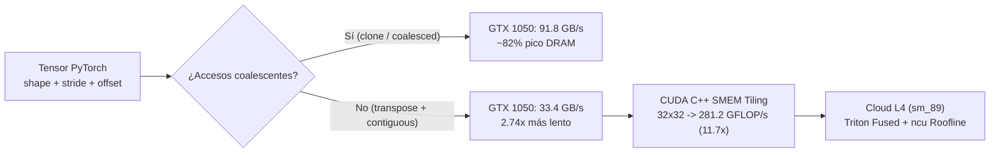

# Curso 1 · Bloque 1: Arquitectura GPU, CUDA C++ y Profiling

<span class="campus-pill pill-mob">[MOB]</span> <span class="campus-pill pill-loc">[LOC] GTX 1050</span> <span class="campus-pill pill-prep">[PREP] → [CLD] L4</span>

**Objetivo del Bloque:** Demostrar por primera vez con mediciones reales dónde está limitado un kernel (*cómputo*, *ancho de banda DRAM/HBM*, *latencia de lanzamiento CPU* o *sincronización CPU-GPU*).



---

## B1.1 · Modelo Roofline, Strides y `.contiguous()` en PyTorch

- **Intensidad Aritmética e Inflexión:**

$$
I = \frac{\text{FLOPs ejecutados}}{\text{Bytes transferidos DRAM}}, \qquad I^* = \frac{\pi_{\text{pico}}}{\beta_{\text{mem}}}
$$

En la **GTX 1050** (`1860 GFLOP/s` FP32 y `112 GB/s`), $I^* \approx 16.6\ \text{FLOP/B}$; en una **H100 SXM** (`989 TFLOP/s` FP16 y `3.35 TB/s` HBM3), $I^* \approx 295\ \text{FLOP/B}$. Un paso de *Decode* con $B=1$ ($I \approx 1\ \text{FLOP/B}$) es siempre **memory-bandwidth bound**.
- **PyTorch Internals:** `.transpose(0, 1)` es *zero-copy* en CPU (`y.data_ptr() == x.data_ptr()`); `.contiguous()` reserva un nuevo buffer y lanza un kernel con accesos *strided*.

=== "Práctica Real (`b1_1_strides/`)"

    - **Código y guía:** [`b1_1_strides/README.md`](../../../b1_1_strides/README.md)
    - **Medición real GTX 1050 (`2048x2048` FP32 = `16 MiB > L2 1 MiB`):**
      - `transpose`: `0.0036 ms` GPU, `0 B` transferidos.
      - `clone()` (coalescente): `0.366 ms` $\rightarrow$ **`91.77 GB/s`** (`81.9 %` del pico).
      - `contiguous()` tras transposición: `1.004 ms` $\rightarrow$ **`33.44 GB/s`** (**2.74x** penalización; **8x** en `8192x8192`).

=== "Smoke Test Offline / Local"

    ```bash
    cd b1_1_strides && ./run.sh --smoke-test
    ```

---

## B1.2 · Fundamentos de CUDA C++: Coalescencia, Tiling SMEM y Warp Shuffles

- **Sectores de 32 B / L2 128 B:** en `gemm_naive`, hilos adyacentes del warp saltan cada $K$ elementos desperdiciando `87.5 %` de cada línea L2. En `gemm_coalesced` (`tx -> col, ty -> row`), las lecturas se empaquetan al `100 %`.
- **Tiling en Shared Memory (`32x32` vs `16x16`):** en Pascal (`65,536` regs/SM, `2048` hilos/SM máx.), `32x32` (`1024` hilos/bloque) cae a 1 bloque/SM (**50 % ocupación**) si supera 32 regs/hilo, mientras `16x16` (`256` hilos/bloque) mejora flexibilidad de bloques concurrentes. En [el código CUDA de B1.2](../../../b1_2_cuda_gemm/gemm_bench.cu) se comparan ambas variantes.
- **Warp Online Softmax:** fusiona cálculo de máximo `m` y normalizador `d` en una sola pasada más escritura mediante `__shfl_down_sync`, reduciendo tráfico DRAM respecto al enfoque *3-pass*.

| Kernel GEMM (`M=N=K=2048` GTX 1050, `artifacts/b1_2_results.csv`) | Rendimiento medido | Speedup vs `naive` |
| :--- | :---: | :---: |
| `gemm_naive` | `24.0 GFLOP/s` | `1.00x` |
| `gemm_coalesced` | `115.6 GFLOP/s` | `4.81x` |
| `gemm_smem_tiled` (`32x32`) | `281.2 GFLOP/s` | `11.69x` |
| `cublasSgemm` | `1627.1 GFLOP/s` | `67.68x` |

- **Práctica y parser:** [`b1_2_cuda_gemm/README.md`](../../../b1_2_cuda_gemm/README.md) · **Resultados completos:** [`INFORME_RESULTADOS.md`](../../../INFORME_RESULTADOS.md)

---

## B1.3 · Profiling Real con Nsight Systems (`nsys`), NVTX y Antipatrones

En [`b1_3_profiling/`](../../../b1_3_profiling/README.md) se midieron 3 antipatrones en GTX 1050 con `nsys` real:

1. **Paginación en copias H2D (tensor `2048x2048` FP32 = `16 MiB`):** activar `pin_memory=True` + `non_blocking` reduce la transferencia de **`3.71 ms` a `1.78 ms` (`2.08x`)** (`INFORME_RESULTADOS.md`, §4).
2. **Sincronización CPU-GPU (`torch.cuda.synchronize()` / `.item()`):** los ~`210 ms` de "espera" de `BAD` no son coste de sincronización, sino la CPU esperando al cómputo ya encolado. Quitar `.item()` apenas mejora el paso completo (`1.01x`: `223.1 ms` $\rightarrow$ `220.7 ms`) porque domina el cómputo de ~600 kernels sin fusionar (`218 ms`, ~`93 GB/s` por kernel).
3. **Solución de fondo (`B1.4`):** requiere fusión de operadores vía `torch.compile` / Triton (`sm_70+`).

---

## B1.4 · Triton y Nsight Compute (`ncu`) (`[PREP]` $\rightarrow$ `[CLD]` 1×L4)

Triton programa a nivel de bloques (`tl.program_id(axis=0)`) vectorizando `tl.load`/`tl.store` sobre MLIR/LLVM para `sm_70+`. En `1x L4` (`sm_89`) cerrarás el ciclo midiendo `ncu --set roofline` (`SM Throughput %` vs `DRAM/HBM Throughput %` y *warp stalls* `stall_long_scoreboard`).

---

## Ejercicios y Autoevaluación del Bloque 1

**Ejercicio B1.1-A (Roofline):** Un modelo denso de $8 \times 10^9$ parámetros en FP16 ejecuta un paso *Decode* ($B=1$, `2 FLOP/param`) en una GPU con `312 TFLOP/s` y `2000 GB/s`. Calcula $I$, compáralo con $I^*$, calcula la latencia mínima y qué batch $B$ iguala el codo Roofline.

??? success "Ver solución B1.1-A"
    - FLOPs paso $B=1$: $2 \times 8 \times 10^9 = 16\ \text{GFLOP}$. Bytes leídos de pesos FP16: `16 GB` $\rightarrow$ $I = 1.0\ \text{FLOP/B}$.
    - Codo Roofline: $I^* = 312\,000 / 2000 = 156\ \text{FLOP/B}$. Como $I \ll I^*$, es **memory-bound**.
    - Latencia mínima teórica: $16\ \text{GB} / 2000\ \text{GB/s} = 8.0\ \text{ms}$. Se necesita $B \approx 156$ tokens concurrentes para saturar cómputo.

**Ejercicio B1.2-A (Ocupación Pascal):** Una variante `32x32` usa 44 registros/hilo en un SM Pascal (`65,536` regs/SM, `2048` hilos/SM). Calcula ocupación frente a `16x16` con los mismos 44 registros/hilo.

??? success "Ver solución B1.2-A"
    - `32x32` (`1024` hilos): $1024 \times 44 = 45\,056\ \text{regs/bloque}$ $\rightarrow$ cabe **1 bloque/SM** = `1024 / 2048` = **50 % ocupación**.
    - `16x16` (`256` hilos): $256 \times 44 = 11\,264\ \text{regs/bloque}$ $\rightarrow$ $\lfloor 65536 / 11264 \rfloor = 5\ \text{bloques/SM}$ = `1280 / 2048` = **62.5 % ocupación**.

### Fuentes Primarias
- Horace He — *Making Deep Learning Go Brrrr From First Principles*: `https://horace.io/brrr_intro.html`
- Modal — *GPU Glossary*: `https://modal.com/gpu-glossary`
- Edward Z. Yang — *PyTorch Internals*: `http://blog.ezyang.com/2019/05/pytorch-internals/`
- Simon Boehm — *CUDA Matmul Optimization*: `https://siboehm.com/articles/22/CUDA-MMM`
- NVIDIA — *Nsight Systems & Nsight Compute Docs*: `https://docs.nvidia.com/nsight-compute/`
