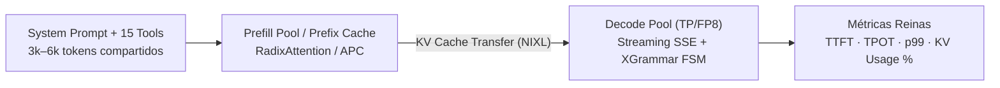

# Curso 1 · Bloque 2: Motores de Inferencia, KV-Cache y Cargas Agénticas

<span class="campus-pill pill-mob">[MOB]</span> <span class="campus-pill pill-loc">[LOC] kv_calc</span> <span class="campus-pill pill-prep">[PREP] B2.2</span> <span class="campus-pill pill-cld">[CLD] L40S/H100</span>

**Objetivo del Bloque:** Dimensionar capacidad exacta de *KV-Cache* (`GQA`/`MLA`), comparar `vLLM` vs `SGLang` bajo carga agéntica real (prefijos compartidos + gramáticas JSON) y entender el desacople *Prefill-Decode* (*PDD*).



---

## B2.1 · Aritmética del KV-Cache (`GQA` y `MLA`)

$$
\text{KV}_{\text{bytes/token}} = 2 \cdot L \cdot n_{\text{kv}} \cdot d_{\text{head}} \cdot b_{\text{kv}}, \qquad \text{MLA (DeepSeek-V3)} = L \cdot (d_c + d_{\text{rope}}) \cdot b_{\text{kv}}
$$

=== "Resultados Reales (`b2_1_kv_cache/`)"

    Ejecutable 100 % offline en [`b2_1_kv_cache/README.md`](../../../b2_1_kv_cache/README.md) (`S=8192`, `gpu_mem_util=0.90`, `overhead=2.0 GB`):

    | Modelo | VRAM útil L40S (`41.2 GiB`) | VRAM útil H100 (`70.0 GiB`) | Nota técnica |
    | :--- | :---: | :---: | :--- |
    | `Llama-3-8B` (FP16 / FP8) | `26` $\rightarrow$ `67` streams | `55` $\rightarrow$ `125` streams | GQA $n_{\text{kv}}=8$ (`128 KiB/tok` FP16) |
    | `Qwen2.5-72B` (FP8 + KV FP16) | `OOM` (pesos `67.7 GiB`) | `0 streams` (`2.29 < 2.50 GiB`) | Entra `1 stream` con KV-FP8; en prod usar `TP >= 2` |
    | `DeepSeek-V3` (FP8 + KV MLA) | Multi-nodo requerido | Mínimo `9×H100` pesos | `34.3 KiB/tok` FP8 en MLA (~9× menos KV) |

=== "Ejecutar Calculadora"

    ```bash
    cd b2_1_kv_cache && ./run.sh
    ```

---

## B2.2 · Comparativa Práctica: `vLLM` (V1) vs `SGLang` (`RadixAttention`)

En [`b2_2_vllm_vs_sglang/`](../../../b2_2_vllm_vs_sglang/README.md) ya está listo el arnés `[PREP]` (`run_compare.sh --dry-run`) con:

1. Carga sintética agéntica (`--prefix-tokens 2048 --output-tokens 64 --json-schema`).
2. Captura de métricas OpenMetrics reales (`vllm:kv_cache_usage_perc` / `sglang:token_usage` y `num_preemptions`).
3. Control de *coordinated omission*: envío en bucle abierto / concurrencia controlada con warmup y percentiles `p50`/`p95`/`p99` de TTFT e ITL/TPOT.

---

## B2.3 · TensorRT-LLM, NVIDIA Dynamo y Disaggregation (`PDD` + `NIXL`)

- Separar pools de **Prefill** (*compute-bound*, optimizado para TTFT) y **Decode** (*bandwidth-bound*, optimizado para TPOT bajo SLA) evita que un prompt largo de `16k` congele la generación en *streaming* de otros 50 usuarios (*head-of-line blocking*).
- La transferencia asíncrona de páginas KV entre ambos pools ocurre vía **NIXL** (RDMA / NVLink).

---

## B2.4 · Cargas Agénticas: Prefix Caching y Constrained Decoding (`XGrammar`)

- **Prefix Caching (`APC` / `RadixAttention`):** evita recomputar $O(S_{\text{pref}}^2)$ en cada turno de herramienta del agente, reduciendo el TTFT de forma notable cuando existe *cache-aware sticky routing* (la magnitud real se mide en `B2.4`, no se asume).
- **Constrained Decoding (`XGrammar` / `llguidance`):** precompila autómatas/gramáticas sobre el vocabulario (`|V| ~ 151,936` en Qwen2.5) en máscara binaria rápida de logits para garantizar JSON Schema `100 %` válido sin introducir pausas CPU.

---

## Ejercicios del Bloque 2

**Ejercicio B2.1-A (Cálculo GQA):** Calcula el KV-Cache en `KiB/token` (FP16) y `GiB` por secuencia ($S=32768$) para $L=40, n_{\text{kv}}=8, d_{\text{head}}=128$. Si los pesos ocupan `28 GiB`, ¿cuántas secuencias de 32k caben en `1x H100` (`70 GiB` útiles)?

??? success "Ver solución B2.1-A"
    - Por token (FP16, `2 B`): $2 \times 40 \times 8 \times 128 \times 2 = 163\,840\ \text{B/tok} = \mathbf{160.0\ \text{KiB/tok}}$.
    - Por secuencia 32k: $32768 \times 160\ \text{KiB} = 5\,242\,880\ \text{KiB} = \mathbf{5.00\ \text{GiB/seq}}$.
    - VRAM libre tras pesos: $70 - 28 = 42\ \text{GiB}$ $\rightarrow$ $\lfloor 42 / 5.0 \rfloor = \mathbf{8\ \text{secuencias}}$ simultáneas.

**Ejercicio B2.4-A (Prefix Caching & Routing):** 50 agentes comparten un prefijo de `3072` tokens y envían `256` tokens nuevos de observación cada turno. Calcula el porcentaje de cómputo de *prefill* ahorrado con cache hit y qué pasa con balanceo *round-robin* ciego.

??? success "Ver solución B2.4-A"
    - Ahorro por hit: $3072 / 3328 = \mathbf{92.3 \%}$ de tokens saltados en prefill tras el primer turno.
    - Con 8 réplicas en *round-robin* ciego sin afinidad de prefijo, el *hit rate* cae a ~`1/8 = 12.5 %`, destruyendo el beneficio del `APC`/`RadixAttention`. Solución: enrutamiento *prefix/hash-aware* + TTL/cache compartida si aplica.

### Fuentes Primarias
- Kwon et al. — *PagedAttention / vLLM Docs*: `https://docs.vllm.ai/`
- Zheng et al. — *SGLang / RadixAttention*: `https://docs.sglang.ai/`
- FlashInfer & XGrammar: `https://docs.flashinfer.ai/` · `https://xgrammar.mlc.ai/docs/`
- NVIDIA Dynamo Architecture: `https://docs.nvidia.com/dynamo/`
