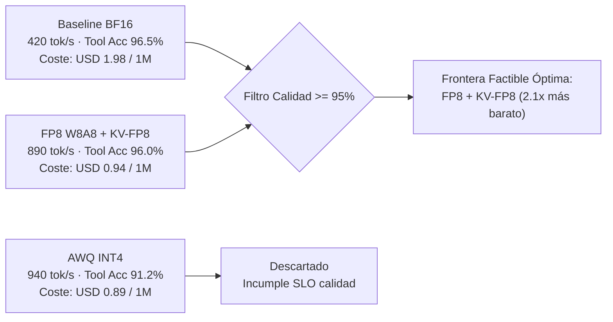

# Curso 1 · Bloque 3: Cuantización, Speculative Decoding y Frontera de Pareto

[MOB] [PREP] [CLD] L40S / H100

**Objetivo del Bloque:** Multiplicar throughput y reducir `$/1M tokens` mediante FP8/AWQ/NVFP4 y decodificación especulativa, demostrando con evaluaciones objetivas que no se degrada el *tool-calling*.

---

## B3.1 · Teoría de Cuantización (`FP8`, `INT4 AWQ/GPTQ`, `NVFP4`)

- **Escala afín y simétrica:** $x_q = \text{clamp}(\text{round}(x/s), -2^{b-1}, 2^{b-1}-1)$.
- **`FP8` (`E4M3` / `E5M2` en `sm_89+`):** acelera *both compute & memory* en Tensor Cores Ada/Hopper con pérdida mínima (`< 0.5 pp`) mediante factores de escala *per-tensor* o *block-wise 128×128* (DeepSeek-V3).
- **`AWQ / GPTQ` (`W4A16`):** reduce pesos a 4 bits manteniendo activaciones en FP16; ideal en **Decode de bajo batch** (*memory-bound*), pero al aumentar batch puede volverse *compute-bound* por el coste de descuantizar `INT4 -> FP16` antes del GEMM.
- **`NVFP4` (`Blackwell B200`):** micro-escalado en bloques de `16` valores con factor FP8 (`E4M3`) soportado nativamente en silicio Tensor Core.

---

## B3.2 · FP8 vs AWQ + KV-Cache FP8 (`[PREP]` $\rightarrow$ `[CLD] Cloud-3`)

Matriz experimental de 4 configuraciones sobre modelos de 14B–32B en `L40S`/`H100`: `BF16`, `AWQ`, `FP8 (W8A8)`, y `FP8 + KV-Cache FP8`.

$$
\text{Coste / 1M tokens} = \frac{C_{\text{GPU}}\ (\text{USD/h})}{\text{tok/s sostenidos} \times 3600} \times 10^6
$$

---

## B3.3 · Speculative Decoding (`EAGLE-3`, `MTP`, `N-Gram`)

Convierte múltiples pasos secuenciales de verificación en un único *forward* en paralelo de $k+1$ tokens: si la tasa media de aceptación es $\alpha$, el número esperado de tokens aceptados por paso es:

$$
E[\text{tokens}] = \frac{1 - \alpha^{k+1}}{1 - \alpha}
$$

**Regla crítica de concurrencia:** funciona excelente en $B \in \{1, 4, 8\}$ (*memory-bound*), pero en batches grandes ($B \ge 32$) verificar $k$ tokens por petición satura los Tensor Cores y puede empeorar la latencia frente al decode estándar.

---

## B3.4 · Evals de Calidad y Frontera de Pareto

Combina `lm-evaluation-harness` / EvalPlus (`HumanEval+`, `gsm8k`) con validación estricta de *tool schemas* JSON para eliminar configuraciones dominadas o que violen los umbrales de producto.

---

## Ejercicios del Bloque 3

**Ejercicio B3.1-A (AWQ vs FP8):** Explica por qué en `1x H100` con $B=1$, AWQ `W4A16` puede superar a `BF16` casi en `2x–3x`, pero con $B=64$ puede perder ventaja frente a `FP8 W8A8`.

??? success "Ver solución B3.1-A"
    Con $B=1$ el decode es **bandwidth-bound**: leer pesos de 4 bits reduce `4x` el tráfico desde HBM respecto a FP16. Con $B=64$ la intensidad aritmética sube hacia la zona **compute-bound**: AWQ sigue ejecutando los Tensor Cores en FP16 más el overhead de descuantizar `INT4 -> FP16`, mientras `FP8 W8A8` duplica directamente los FLOP/s de los Tensor Cores respecto a FP16.

**Ejercicio B3.3-A (Speculative Decoding):** Con $k=4$ tokens propuestos y $\alpha = 0.70$, calcula $E[\text{tokens}]$ por verificación y explica si compensa cuando el verificador con $k=4$ tarda `1.45x` el tiempo de un paso estándar.

??? success "Ver solución B3.3-A"
    - Con $\alpha=0.70, k=4$: $\frac{1 - 0.70^5}{1 - 0.70} = \frac{1 - 0.168}{0.30} \approx \mathbf{2.77\ \text{tokens/paso}}$.
    - Speedup neto: $2.77 / 1.45 \approx \mathbf{1.91x}$ siempre que el batch sea suficientemente bajo para no saturar cómputo.

**Ejercicio B3.4-A (FinOps & Pareto):** En una H100 (`$3.00/h`): BF16 logra `420 tok/s` (`96.5%` tool acc), FP8+KV-FP8 `890 tok/s` (`96.0%`), AWQ `940 tok/s` (`91.2%`). Con SLO `Tool Accuracy >= 95 %`, calcula costes y elige la configuración óptima.

??? success "Ver solución B3.4-A"
    - `BF16`: `$1.98 / 1M` · `FP8+KV-FP8`: `$0.94 / 1M` · `AWQ`: `$0.89 / 1M`.
    - `AWQ` incumple el SLO (`91.2 % < 95 %`). La configuración ganadora en la frontera factible de Pareto es **FP8 W8A8 + KV-FP8** (`$0.94 / 1M`, `2.1x` más barata que BF16).

### Fuentes Primarias
- Hugging Face Quantization & `llm-compressor`: `https://huggingface.co/docs/transformers/quantization/overview`
- vLLM Speculative Decoding Docs: `https://docs.vllm.ai/en/latest/features/spec_decode.html`
- EleutherAI `lm-evaluation-harness`: `https://github.com/EleutherAI/lm-evaluation-harness`
