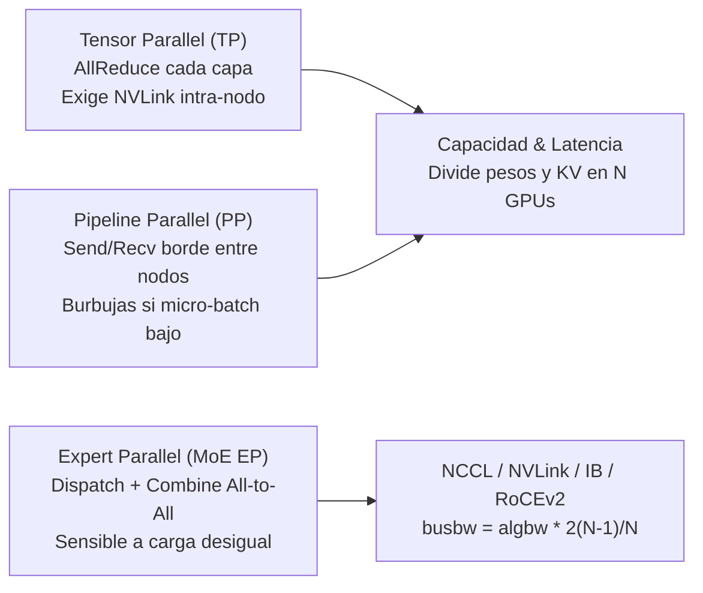

# Curso 1 · Bloque 4: Inferencia Distribuida, MoE, PDD Avanzado y Redes

[MOB] [PREP] [CLD] 2×–8× H100

**Objetivo del Bloque:** Escalar modelos que no caben en una GPU o que exigen baja latencia distribuyendo capas, tensores o expertos (`TP/PP/DP/EP`) sin ahogarse en comunicaciones colectivas `NCCL`.

---

## B4.1 · Paralelismo (`DP`, `TP`, `PP`, `CP`, `FSDP`) y Colectivas NCCL

| Estrategia | Qué particiona | Colectiva crítica | Dónde escala bien |
| :--- | :--- | :--- | :--- |
| **TP** (*Tensor*) | Heads de atención y columnas/filas MLP | `AllReduce` (2 por capa Transformer) | Intra-nodo sobre **NVLink / NVSwitch** |
| **PP** (*Pipeline*) | Bloques de capas contiguas | `P2P Send/Recv` entre bordes | Inter-nodo con *micro-batching* `1F1B` |
| **DP** (*Data*) | Réplicas completas del modelo | Gradientes en entreno (`0` en inferencia) | Máximo throughput lineal |
| **CP** (*Context*) | Secuencia de `128k–1M` tokens (*Ring Attention*) | P2P / `AllGather` de K,V | Contextos ultra-largos en Prefill |

---

## B4.2 · Mixture-of-Experts (`MoE`) y Wide Expert Parallelism (`EP`)

- En modelos tipo DeepSeek-V3 (`671B` totales, `37B` activos, `256` expertos enrutados), combinar `DP` en atención + `EP` en expertos FFN sustituye el `AllReduce` denso por dos colectivas **`All-to-All` (*Dispatch* $\rightarrow$ cómputo $\rightarrow$ *Combine*)**.
- En NVLink/NVSwitch intra-nodo (`H100`/`GB200`) la latencia es sub-milisegundo; cruzar redes Ethernet/IB sin *overlapping* de cómputo y comunicación dispara las burbujas.

---

## B4.3 · Disaggregation (`PDD`) Avanzado, LMCache y Routing Cache-Aware

Evaluación multi-GPU de `1P1D` (1 nodo Prefill + 1 nodo Decode con transferencia `KV` vía NIXL / LMCache) frente a `DP=2` colocalizado bajo ráfagas de prompts largos + cola SSE sensible al TTFT.

---

## B4.4 · Interconexiones NVLink / InfiniBand / RoCEv2 y `nccl-tests`

En un **`Ring AllReduce`** entre $N$ GPUs con tamaño de mensaje $M$:

$$
\text{algbw} = \frac{M}{t}, \qquad \text{busbw} = \text{algbw} \times \frac{2(N - 1)}{N}
$$

El factor $2(N-1)/N$ recoge las dos pasadas (`ReduceScatter` + `AllGather`). En `8x H100` SXM sobre NVSwitch (`~450 GB/s` unidireccional por GPU), un `all_reduce_perf` sano supera `350–400 GB/s` de `busbw` en mensajes grandes (`>= 256 MB`).

---

## Ejercicios del Bloque 4

**Ejercicio B4.1-A (Presupuesto AllReduce en TP=8):** En `TP=8` (`40` capas, `2` AllReduce por capa en `FP16`, hidden `5120`, batch decode `B=16`), calcula el volumen transmitido por token generado y explica por qué `TP=8` colapsa sobre PCIe Gen4 (`~24 GB/s`) pero vuela en NVSwitch.

??? success "Ver solución B4.1-A"
    - Tensor de activación: $M = 16 \times 5120 \times 2\ \text{B} = 160\ \text{KiB}$.
    - Con `80` AllReduce/token y factor $2(7)/8 = 1.75$: tráfico físico total = $80 \times 1.75 \times 160\ \text{KiB} = \mathbf{21.9\ \text{MiB}}\ (22\,400\ \text{KiB})$ en 80 barreras síncronas.
    - Sobre PCIe (`~24 GB/s` + micro-latencias de `15 us/barrera`): las latencias de sincronización suman ~`1.2–2 ms` solo de red en un paso que debería durar pocos milisegundos. Sobre NVLink/NVSwitch (`450 GB/s`, < `2 us`), el overhead es despreciable.

**Ejercicio B4.4-A (`busbw` en `8x H100`):** `all_reduce_perf -b 512M` reporta `algbw = 210.5 GB/s`. Calcula `busbw` y diagnostica si indica NVLink activo o caída silenciosa a PCIe/SHM.

??? success "Ver solución B4.4-A"
    $$\text{busbw} = 210.5 \times \frac{2(8-1)}{8} = 210.5 \times 1.75 = \mathbf{368.4\ \text{GB/s}}$$
    Está claramente en rango sano de NVLink/NVSwitch (PCIe habría quedado en `~15–25 GB/s`).

### Fuentes Primarias
- NCCL Tests (`NVIDIA/nccl-tests`): `https://github.com/NVIDIA/nccl-tests`
- Megatron-Core Parallelism Guide: `https://docs.nvidia.com/megatron-core/developer-guide/latest/`
- DeepSeek-V3 Technical Report: `https://arxiv.org/abs/2412.19437`
- LMCache Docs: `https://docs.lmcache.ai/`
