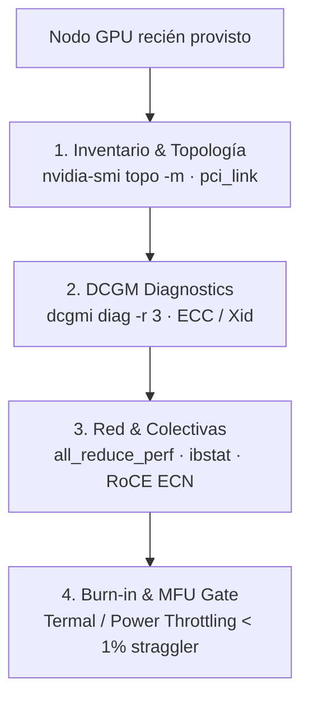

# Curso 1 · Bloque 5: Benchmarking Científico, Cluster Acceptance y K8s GPU

[MOB] [LOC] [PREP] [CLD] Cloud-5

**Objetivo del Bloque:** Garantizar aceptación física de clústeres GPU recién entregados (`dcgmi`, errores ECC/Xid, *burn-in* térmico y de energía), calcular `MFU` real y operar GPU en Kubernetes con aislamiento (`MIG`) y arranque rápido.

---

## B5.1 · Metodología de Benchmarking Reproducible (Sin Autoengaños)

Checklist obligatorio antes de publicar cualquier número (`[LOC]`):

1. Fijar semillas, versión exacta de driver/CUDA/PyTorch y estado de relojes GPU (*clocks* / *power limit*).
2. Descartar iteraciones de **warmup** y promediar mínimo 3 pasadas verificando varianza/percentiles (`p50`, `p95`, `p99`), nunca solo la media.
3. Registrar entorno completo en JSON para que otros reproduzcan sin modificar rutas absolutas.

---

## B5.2 · Cluster Acceptance Testing (`dcgmi`, Xid, Burn-in Térmico)

En el momento en que un proveedor entrega un clúster de 8–64 GPUs:

- **`dcgmi diag -r 3`** (diagnóstico extendido GPU/memoria/PCIe) y vigilancia de contadores `DBE` (*Double-Bit Uncorrectable ECC Errors*), páginas retiradas de HBM (`retired_pages`) y logs del kernel `dmesg | grep NVRM` buscando **`Xid` críticos** (`Xid 48` DBE, `Xid 79` GPU fallen off the bus, `Xid 74` fallo NVLink).
- **Stragglers:** en un trabajo síncrono (`DDP`/`FSDP`/`AllReduce`), **1 GPU degradada por *thermal throttling* o enlace `PCIe Gen2/Gen3` frena al `100 %` del clúster**.

---

## B5.3 · Entrenamiento con Megatron-LM, `MFU` y Cuellos de Red (`RoCEv2` vs `IB`)

$$
\text{MFU} = \frac{6 \cdot N_{\text{params}} \cdot \text{tokens/s}}{\text{Peak FLOPs}_{\text{hardware}}}
$$

Un `MFU` sano en H100 sobre Megatron ronda `40–55 %`. Si cae por debajo del `30 %` mientras `nsys` muestra largos huecos entre kernels de cómputo y `ncclKernel_AllReduce`, la causa suele ser pérdida de paquetes/`PFC` en **RoCEv2**, desequilibrio de etapas **PP**, o **CPU dataloading starvation**.

---

## B5.4 · Kubernetes GPU, `MIG`, *Time-Slicing* y *Cold Starts*

| Mecanismo K8s | Aislamiento memoria/SM | Cuándo usarlo | Limitación |
| :--- | :--- | :--- | :--- |
| **GPU completa** | Exclusiva (`100 %`) | Serving LLM pesado (`vLLM`/`TRT-LLM`) y entreno | Baja utilización con modelos pequeños |
| **MIG** (*Multi-Instance GPU*, `A100`/`H100`) | **Aislamiento hardware** de SMs y canales HBM | Multi-tenant productivo con SLO estricto de latencia | Máx. `7` instancias; particiones fijas |
| **Time-Slicing** | Compartida sin aislamiento | Notebooks/dev (`RTX`/`L4`/`GTX`) sin garantías SLA | Riesgo OOM mutuo y jitter de latencia |

Para mitigar **cold starts** (de minutos al descargar `70 GB` desde HF/S3): usar **Fast-Path caching local NVMe**, formatos de carga directa **Safetensors** mapeados o **Run:ai Model Streamer** / snapshots EBS/Lustre pre-hidratados.

---

## Ejercicios del Bloque 5

**Ejercicio B5.3-A (Cálculo de MFU):** Entrenas un modelo denso de `70B` en `8x H100` (`989 TFLOP/s` BF16 cada una) logrando `9,000 tokens/s` globales. Calcula el `MFU` real.

??? success "Ver solución B5.3-A"
    - FLOPs útiles por segundo: $6 \times (70 \times 10^9) \times 9000 = 3.78 \times 10^{15}\ \text{FLOP/s} = 3780\ \text{TFLOP/s}$.
    - Techo hardware del nodo: $8 \times 989 = 7912\ \text{TFLOP/s}$.
    - $\text{MFU} = 3780 / 7912 = \mathbf{47.8 \%}$ (valor saludable para `8x H100` en BF16).

**Ejercicio B5.2-A (Diagnóstico de Clúster):** Al arrancar `nccl-tests` en 2 nodos (`16x H100`), un nodo tiene `GPU 3` a `87 °C` bajando reloj de `1980 MHz` a `1150 MHz` y aumentando su tiempo de step de `240 ms` a `410 ms`. ¿Qué efecto produce en el resto de GPUs y cómo lo demuestras antes de aceptar los nodos?

??? success "Ver solución B5.2-A"
    Todas las demás 15 GPUs quedan bloqueadas esperando en el `AllReduce` de final de paso (subiendo el step global de `240 ms` a `410 ms`, `-41 %` de throughput total). Evidencia: `nvidia-smi dmon` (columna `sm`, `temp`, `pviol`/`tviol`), `dcgmi diag -r 3` y perfilado por rango en `nsys` donde 15 ranks muestran espera `ncclAllReduce` esperando al rank 3. Rechazar / sustituir módulo térmico o pasta antes de firmar aceptación.

### Fuentes Primarias
- NVIDIA DCGM & Xid Errors Reference: `https://docs.nvidia.com/datacenter/dcgm/` · `https://docs.nvidia.com/deploy/xid-errors/`
- NVIDIA MIG User Guide & GPU Operator: `https://docs.nvidia.com/datacenter/tesla/mig-user-guide/`
- MLPerf & Stas Bekman ML Engineering Book: `https://github.com/stas00/ml-engineering`
