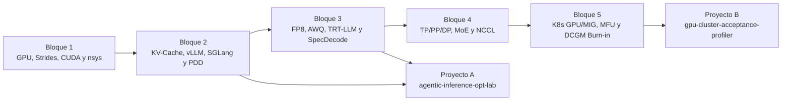

  Curso 1 · Itinerario AI Infrastructure &amp; GPU Systems
  <h1>Del Silicio CUDA a Clústeres Multi-GPU</h1>
  
5 bloques y 20 unidades didácticas (`B1.1`–`B5.4`) para dominar memoria GPU, kernels CUDA/Triton, motores vLLM/SGLang/TensorRT-LLM, cuantización FP8, MoE/NCCL y benchmarking reproducible de clústeres.

## Grafo de Dependencias y Proyectos del Curso 1

## Tabla de Hardware Local vs. Cloud (`[LOC]` vs. `[PREP]`→`[CLD]`)

| Entorno | GPU | Arquitectura | VRAM | Qué unidades ejecuta |
| :--- | :--- | :--- | :---: | :--- |
| **Portátil Local (`[LOC]`)** | NVIDIA GeForce GTX 1050 | Pascal `sm_61` | **2 GB** | `B1.1`, `B1.2`, `B1.3`, `B2.1`, `B5.1`, simuladores/calculadoras |
| **Cloud L4 (`[CLD]`)** | NVIDIA L4 | Ada `sm_89` | 24 GB | `B1.4` (`torch.compile` + Triton + `ncu`) |
| **Cloud L40S (`[CLD]`)** | NVIDIA L40S | Ada `sm_89` | 48 GB | `B2.2`, `B2.4`, `B3.x` (FP8 nativo en nodo único) |
| **Cloud H100 (`[CLD]`)** | NVIDIA H100 (1× / 2×–8×) | Hopper `sm_90` | 80 GB | `B3.x`, `B4.3`, `B4.4`, `B5.2`, `B5.3` (NVLink, multi-GPU) |

## Módulos del Curso 1

| Bloque | Unidades | Estado en Repo | Enlace al Módulo |
| :--- | :--- | :---: | :--- |
| **Bloque 1** | `B1.1` Strides · `B1.2` CUDA C++ · `B1.3` `nsys`/`perf` · `B1.4` Triton/`ncu` | ✅ Local `B1.1`–`B1.3` | [Abrir Bloque 1 →](b1-arquitectura-cuda.md) |
| **Bloque 2** | `B2.1` KV-Cache · `B2.2` vLLM vs SGLang · `B2.3` TRT-LLM/Dynamo · `B2.4` Agentes | ✅ `B2.1` / 🟡 `B2.2 [PREP]` | [Abrir Bloque 2 →](b2-motores-kv-cache.md) |
| **Bloque 3** | `B3.1` Cuantización · `B3.2` FP8 vs AWQ · `B3.3` SpecDecode · `B3.4` Evals Pareto | ⬜ `[PREP]` / `[CLD]` | [Abrir Bloque 3 →](b3-cuantizacion-pareto.md) |
| **Bloque 4** | `B4.1` TP/PP/DP · `B4.2` MoE/EP · `B4.3` PDD/LMCache · `B4.4` `nccl-tests` | ⬜ `[MOB]` / `[CLD]` | [Abrir Bloque 4 →](b4-paralelismo-moe-nccl.md) |
| **Bloque 5** | `B5.1` Benchmarking · `B5.2` DCGM/Xid · `B5.3` Megatron/MFU · `B5.4` K8s/MIG | ⬜ `[LOC]` / `[CLD]` | [Abrir Bloque 5 →](b5-cluster-benchmarking.md) |

- **Manual PDF del Curso 1:** [Descargar `Curso_1_AI_Infrastructure_GPU.pdf`](../../pdf/Curso_1_AI_Infrastructure_GPU.pdf)
- **Playbook maestro original:** [Leer `00-master-playbook.md`](../../temario/00-master-playbook.md)
- **Resultados medidos reales:** [Ver `INFORME_RESULTADOS.md`](../../../INFORME_RESULTADOS.md)
