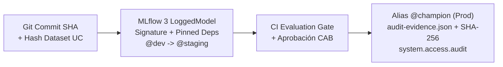

# Curso 2 · Bloque 1 (`CHAT-B1`): Databricks, MLflow 3 y Gobernanza por Diseño

<span class="campus-pill pill-mob">[MOB]</span> <span class="campus-pill pill-loc">[LOC] Docker + MLflow</span> <span class="campus-pill pill-lab">[LAB] Databricks Free/Trial</span>

**Objetivo del Bloque:** Dominar la arquitectura **Databricks Data Intelligence Platform** frente a **Kubernetes/Seldon**, implantar promoción inmutable `dev -> test -> prod` con **MLflow 3** (`LoggedModel`, aliases y provenance) y automatizar cumplimiento normativo con **Unity Catalog** (*Governance-by-Design*).



---

## B1.1 · Databricks Mosaic AI vs. Topologías Kubernetes / Seldon (`ADR-001`)

| Criterio de Decisión | Databricks Mosaic AI Serverless | Kubernetes (`Seldon Core v2` / `Knative` + `Istio`) |
| :--- | :--- | :--- |
| **Plano de control / red** | Control Plane en Databricks + Serverless VPC gestionada via PrivateLink | Control total de CNI, `mTLS`, egress custom y GPU driver/kernel flags |
| **Gobernanza y linaje** | Nativa en Unity Catalog (`system.access.audit`, `system.billing.usage`) | Requiere integrar Keycloak/OPA, MLflow externo y OpenLineage |
| **Portabilidad multi-cloud** | Dependencia de plataforma Databricks (multi-cloud vía workspaces) | 100 % portable entre AWS EKS, Azure AKS y on-premise |
| **Cuándo elegirlo** | Datos ya en Lakehouse, velocidad de entrega, cumplimiento rápido | *Traffic shadowing*, GPUs exóticas, multi-model pipelines complejos |

**Entregable:** `docs/adr/001-serving-topology-databricks-vs-seldon.md` defendible en 3 minutos en entrevista técnica.

---

## B1.2 · Ciclo de Vida con MLflow 3 (`LoggedModel`, Aliases y Provenance)

- **`LoggedModel`:** empaqueta código del grafo del agente, *system prompts*, esquemas de herramientas, firma entrada/salida (`ChatCompletionRequest`) y dependencias congeladas (`uv.lock` / `requirements.txt`).
- **Aliases frente a Stages Legacy:** en lugar de *stages* rígidos (`Staging`/`Production`), se mueven aliases mutables (`@dev` $\rightarrow$ `@staging` $\rightarrow$ `@challenger` $\rightarrow$ `@champion`) apuntando siempre a versiones **inmutables**.

=== "Gate Python en CI (`promote_gate.py`)"

    ```python
    from mlflow.tracking import MlflowClient

    def promote_to_champion(model_name: str, version: str) -> None:
        client = MlflowClient()
        mv = client.get_model_version(name=model_name, version=version)
        required = {"git_commit_sha", "artifact_sha256", "eval_passed", "approved_by"}
        missing = required - set(mv.tags.keys())
        assert not missing and mv.tags["eval_passed"] == "true", f"Gate bloqueado: {missing}"
        client.set_registered_model_alias(name=model_name, alias="champion", version=version)
    ```

=== "Docker Compose Local `[LOC]`"

    ```bash
    # Arranque rápido para laboratorio local de MLflow Tracking + Registry
    mlflow server --host 127.0.0.1 --port 5000 --backend-store-uri sqlite:///mlflow.db
    ```

---

## B1.3 · Unity Catalog Lineage, RBAC/ABAC y `audit-evidence.json`

Namespace de 3 niveles `catalog.schema.object` cubriendo tablas Delta (*Time Travel*), *Volumes*, *Vector Search Indexes*, herramientas SQL/Python y modelos registrados, alimentando auditoría nativa (`system.access.audit`) y costes (`system.billing.usage`).

---

## Ejercicios del Bloque 1

**Ejercicio C2-B1-A (Trazabilidad en Auditoría):** Un auditor exige saber exactamente qué documentos alimentaban el RAG el día 12 a las 14:00 UTC cuando falló una respuesta, qué versión de prompt respondió y quién aprobó su pase a producción. ¿Qué objetos de Unity Catalog + MLflow responden sin depender de logs efímeros?

??? success "Ver solución C2-B1-A"
    1. **Documentos:** tabla Delta fuente `catalog.schema.docs` mediante *Delta Time Travel* (`TIMESTAMP AS OF`) + linaje automático al *Vector Search Index*.
    2. **Código y Prompt:** versión exacta ligada al alias `@champion` en ese timestamp en `system.access.audit` (`git_commit_sha`, `run_id`, artefactos del `LoggedModel`).
    3. **Aprobación:** tag inmutable `approved_by` + merge SHA del PR + `audit-evidence.json` firmado con SHA-256.

**Ejercicio C2-B1-B (Inmutabilidad):** Un desarrollador edita directamente tags/artefactos de la versión `v4` (`@champion`) para corregir un typo en el *system prompt*. ¿Por qué rompe auditoría y cómo lo bloqueas?

??? success "Ver solución C2-B1-B"
    Mutar `v4` in-place invalida el `artifact_sha256`, rompe reproducibilidad post-mortem y anula *rollbacks*. Solución: revocar permiso `MODIFY` a usuarios humanos sobre el registro de producción; únicamente el *Service Principal* del pipeline CI puede registrar `v5`, ejecutar el gate de evaluación y mover el alias `@champion`.

### Fuentes Primarias
- Databricks Docs — *Mosaic AI Model Serving & Deploy AI Agents*: `https://docs.databricks.com/en/machine-learning/model-serving/`
- Databricks Docs — *Unity Catalog Lineage & System Tables*: `https://docs.databricks.com/en/data-governance/unity-catalog/`
- MLflow Docs — *Model Registry, Aliases & GenAI Lifecycle*: `https://mlflow.org/docs/latest/`
