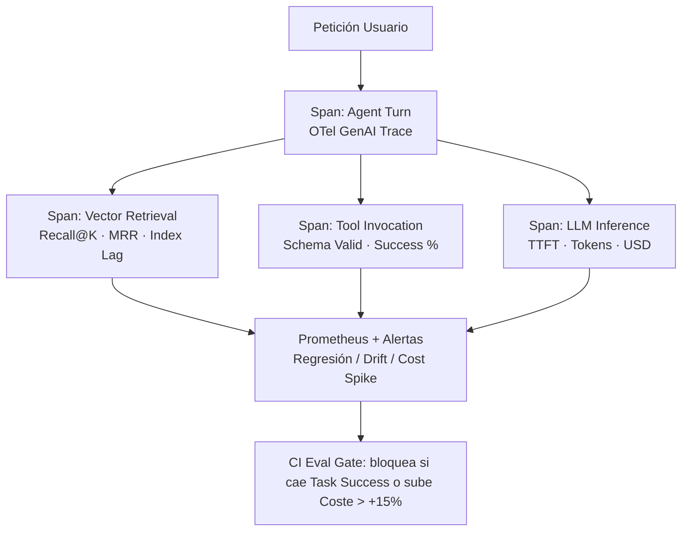

# Curso 2 · Bloque 2 (`CHAT-B2`): Evals Agénticas, RAG Health, OTel y FinOps

<span class="campus-pill pill-mob">[MOB]</span> <span class="campus-pill pill-loc">[LOC] Python + OpenSearch + Prometheus</span>

**Objetivo del Bloque:** Sustituir las pruebas manuales por evaluación automática de **trayectorias agénticas** (`mlflow.genai.evaluate()`), aislar fallos de *Retrieval* frente a *Generation* en RAG y proteger costes/latencia con **OpenTelemetry + Circuit Breakers FinOps**.



---

## B2.1 · Evaluación de Agentes (`mlflow.genai.evaluate()`) como Gate de CI

Se miden 4 dimensiones sobre un **Golden Dataset** versionado (`15–50` casos reales + edge cases adversariales):

1. **Task Success** (objetivo completo resuelto).
2. **Tool Selection & Argument Validity** (`JSON Schema` válido, sin parámetros alucinados).
3. **Trajectory Efficiency** (penaliza llamadas redundantes o bucles infinitos).
4. **Safety / Prompt Injection Resistance**.

=== "Evaluation Gate (`eval_gate.py`)"

    ```python
    import mlflow

    results = mlflow.genai.evaluate(
        data=golden_eval_df,
        predict_fn=agent_predict,
        scorers=[task_success_scorer, tool_validity_scorer, safety_scorer],
    )
    metrics = results.metrics
    assert metrics["task_success/mean"] >= 0.90, "Regresión en Task Success"
    assert metrics["tool_validity/mean"] >= 0.95, "Regresión en Tool Schema Validity"
    ```

---

## B2.2 · Calidad y Salud Operacional de RAG (`OpenSearch` / `Vector Search`)

| Plano | Qué mide | Cómo actuar si falla |
| :--- | :--- | :--- |
| **Offline Quality** | `Context Recall@K`, `MRR`, `NDCG` sobre pares `(query, doc_id)` | Ajustar chunking/overlap, búsqueda híbrida BM25 + densa y reranker |
| **Production Health** | `rag_empty_hits_ratio`, `vector_latency_p95`, **`rag_index_lag_seconds`** | Reparar pipeline de embeddings/CDC antes de tocar prompts del LLM |
| **Generation** | `Faithfulness` (fidelidad al contexto recuperado) | Si retrieval es sano pero faithfulness cae $\rightarrow$ ajustar prompt/temperatura |

---

## B2.3 · OpenTelemetry GenAI, Drift y FinOps Circuit Breakers

$$
\text{Coste conversación} = \sum_{\text{turnos}} \left(\frac{T_{\text{in}} \cdot P_{\text{in}} + T_{\text{out}} \cdot P_{\text{out}}}{10^6}\right)
$$

Instrumentar atributos de las convenciones semánticas OTel GenAI (`gen_ai.provider.name` —`gen_ai.system` está deprecado—, `gen_ai.usage.input_tokens`, `gen_ai.usage.output_tokens`, `gen_ai.tool.name`) más atributos propios de negocio como `tenant_id` (no estándar, prefíjalo con tu namespace) y aplicar **límites estrictos**: `max_steps_per_turn`, `max_tokens_per_session`, detección de invocación repetida de herramienta con mismos argumentos y caché semántica para preguntas frecuentes.

---

## Ejercicios del Bloque 2

**Ejercicio C2-B2-A (Diagnóstico RAG vs LLM):** `task_success` cae del `93 %` al `71 %`. Ves: `faithfulness = 0.96`, `llm_ttft_p95 = 210 ms`, pero `rag_empty_hits_ratio` subió del `3 %` al `28 %` y `rag_index_lag_seconds` pasó de `120 s` a `86,400 s`. ¿Dónde está la causa raíz?

??? success "Ver solución C2-B2-A"
    Fallo de **pipeline de ingesta/indexación vectorial (*Retrieval failure*)**: el modelo sigue siendo fiel al contexto que recibe (`96 %`), pero el índice lleva 24h desactualizado (`index_lag = 86,400 s`) devolviendo vacíos. Reparar sincronización incremental/embeddings antes de cambiar LLM o prompts.

**Ejercicio C2-B2-B (FinOps Circuit Breaker):** Un agente entra en bucle llamando a `search_docs` (`2,500` tokens in + `400` tokens out por turno; precios `$3.00 / 1M` input y `$15.00 / 1M` output). Compara `25` iteraciones sin control frente a `max_steps = 5` + detección de llamadas duplicadas (corte en paso 2).

??? success "Ver solución C2-B2-B"
    - Coste por iteración: $(2500 \times 3 + 400 \times 15) / 10^6 = \$0.0135$.
    - Con 25 iteraciones sin freno: **`$0.3375` por conversación** (`10,000` peticiones = **`$3,375`** en un solo incidente).
    - Con `max_steps = 5` + corte en repetición (2 pasos): acotado a **`$0.027 – $0.0675`** (**5x–12x menos** gasto).

> **Estabilidad:** las convenciones GenAI de OpenTelemetry siguen en estado *Development* y se han movido al repositorio `open-telemetry/semantic-conventions-genai`; comprueba los nombres vigentes antes de fijar dashboards.

### Fuentes Primarias
- MLflow GenAI Evaluation & Tracing: `https://mlflow.org/docs/latest/genai/eval-monitor/` · `https://mlflow.org/docs/latest/tracing/`
- OpenTelemetry Semantic Conventions for GenAI: `https://opentelemetry.io/docs/specs/semconv/gen-ai/`
- OpenSearch Vector Search: `https://opensearch.org/docs/latest/search-plugins/knn/`
