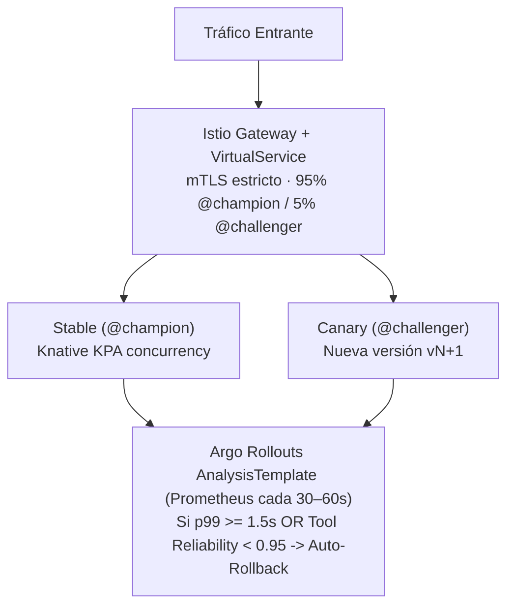

# Curso 2 · Bloque 3 (`CHAT-B3`): Serving en K8s, Istio, ArgoCD y Crossplane

<span class="campus-pill pill-mob">[MOB]</span> <span class="campus-pill pill-loc">[LOC] Kind + Knative + Istio + Argo + Crossplane</span>

**Objetivo del Bloque:** Construir la capa de ejecución cloud-native y GitOps en Kubernetes: *serving* con **Seldon Core v2** / **Knative** (autoscaling por concurrencia), despliegue progresivo **Istio + Argo Rollouts** con auto-rollback y abstracción de plataforma con **Crossplane**.



---

## B3.1 · Seldon Core v2 vs. Knative Serving (KPA por Concurrencia)

- **Seldon Core v2:** pipelines declarativos multi-etapa desacoplados sobre Kafka/gRPC (`Model` + `Pipeline` CRD): *Guardrail PII $\rightarrow$ Retrieval $\rightarrow$ LLM $\rightarrow$ Verifier*, más soporte *multi-model serving*.
- **Knative Serving (`KPA`):** escala por **concurrencia real de peticiones en vuelo** (`containerConcurrency` / `autoscaling.knative.dev/target`) en lugar de CPU `%` (un pod de agente esperando respuesta del LLM o de una tool tiene CPU al `5 %` aunque tenga todos sus hilos saturados), y soporta *scale-to-zero* en `dev`/`staging`.

=== "Manifiesto Knative (`Service`)"

    ```yaml
    apiVersion: serving.knative.dev/v1
    kind: Service
    metadata:
      name: agentic-orchestrator
      namespace: ai-staging
    spec:
      template:
        metadata:
          annotations:
            autoscaling.knative.dev/metric: "concurrency"
            autoscaling.knative.dev/target: "10"
            autoscaling.knative.dev/min-scale: "0"
            autoscaling.knative.dev/max-scale: "8"
        spec:
          containers:
            - image: ghcr.io/org/agentic-orchestrator:sha-1a2b3c
              ports: [{ containerPort: 8080 }]
    ```

=== "Argo Rollouts (`AnalysisTemplate`)"

    ```yaml
    apiVersion: argoproj.io/v1alpha1
    kind: AnalysisTemplate
    metadata:
      name: agent-slo-gate
    spec:
      metrics:
        - name: tool-reliability
          interval: 30s
          successCondition: result[0] >= 0.95
          failureLimit: 2
          provider:
            prometheus:
              address: http://prometheus.monitoring:9090
              query: avg(agent_tool_reliability_ratio{version="canary"})
    ```

---

## B3.2 · Istio Service Mesh y ArgoCD + Argo Rollouts

1. **Shadow Mirroring (`VirtualService.mirror`):** duplica tráfico real de producción de forma asíncrona (*fire-and-forget*) antes de exponer al `@challenger` a usuarios reales.
2. **Seguridad y Resiliencia:** mTLS `STRICT`, *timeouts* acotados y *circuit breakers* (`outlierDetection`) en `DestinationRule` — **nunca** habilitar *retries* automáticos de mesh en herramientas mutantes no idempotentes (`POST /refund`, `create_ticket`).

---

## B3.3 · Crossplane Golden Paths, PrivateLink y Zero-Trust Identity

Los equipos de producto consumen un único **XRD (`XAgenticEnvironment`)** en lugar de mantener cientos de líneas Terraform duplicadas; la **Composition** aprovisiona automáticamente bucket KMS-cifrado, índice vectorial, **AWS PrivateLink / Azure Private Endpoint** (cero tráfico por Internet público) e identidad federada efímera (**IRSA** / **Workload Identity**) sin secretos estáticos.

---

## Ejercicios del Bloque 3

**Ejercicio C2-B3-A (Mesh Retries):** Un equipo configura `retries: attempts: 3` en el `VirtualService` de Istio para todas las rutas de herramientas, incluyendo `POST /tools/refund_payment` con `timeout: 2s`. Explica los dos fallos graves que genera en producción y su solución.

??? success "Ver solución C2-B3-A"
    1. **Duplicación no idempotente:** si un reembolso tarda `2.1 s` en backend, Istio corta a los `2 s` y reintenta hasta 3 veces $\rightarrow$ múltiples cobros/reembolsos reales por la misma petición.
    2. **Tormenta de reintentos (*Retry Storm*):** bajo saturación multiplica `4x` el tráfico contra un servicio ya degradado.
    **Solución:** deshabilitar reintentos de Istio en endpoints `POST` mutantes, exigir cabecera `Idempotency-Key`, ajustar timeout al presupuesto real + margen y proteger con `outlierDetection`.

### Fuentes Primarias
- Seldon Core v2 Docs: `https://docs.seldon.io/projects/seldon-core/en/v2/`
- Knative Serving Autoscaling: `https://knative.dev/docs/serving/autoscaling/`
- Istio Traffic Management & Argo Rollouts: `https://istio.io/latest/docs/tasks/traffic-management/` · `https://argo-rollouts.readthedocs.io/`
- Crossplane Docs: `https://docs.crossplane.io/`
