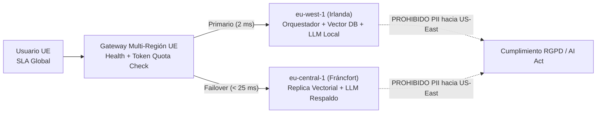

# Curso 2 · Bloque 4 (`CHAT-B4`): Operación SRE, SLOs Agénticos y Multi-Región

[MOB] [LOC] Runbooks + GameDay

**Objetivo del Bloque:** Definir SLIs/SLOs significativos para sistemas no deterministas, dirigir un simulacro real de incidente (*GameDay* + *Post-Mortem blameless*) y diseñar topologías multi-región UE con soberanía de datos y *graceful degradation*.

---

## B4.1 · SLIs, SLOs y Error Budgets Agénticos

| Tipo SLI | Métrica | SLO sugerido | Acción al agotar Error Budget |
| :--- | :--- | :---: | :--- |
| **Disponibilidad HTTP/SSE** | Peticiones no-`5xx` sin aborto de stream | `99.9 %` (30d) | Congelar releases de features; priorizar fiabilidad |
| **Latencia TTFT / End-to-End** | `TTFT p95 <= 1.2s`, turno completo `p95 <= 6.0s` | `99 %` turnos | Activar modelo ligero *fallback* / recortar top-K |
| **Calidad Agéntica (Functional SLI)** | `Tool Call Validity >= 98 %`, `Task Success >= 90 %` | Continuo | Bloquear promociones MLflow; disparar Argo Rollback |

---

## B4.2 · GameDay, Simulacro de Incidente y Post-Mortem Blameless

Escenario integrado en el proyecto *Golden Path*: inyección controlada de fallo (caída de `index_lag` en OpenSearch, latencia 10× en herramienta externa o agotamiento TPM), detección mediante alertas de *burn rate*, mitigación en 5 minutos (`circuit breaker` + *fallback* a modelo pequeño + rollback Argo) y redacción de **Post-Mortem Blameless** con acciones preventivas verificables en código.

---

## B4.3 · Arquitectura Multi-Región, Soberanía de Datos y Baja Latencia

- **Colocación geográfica (*Co-location*):** en un agente RAG de 3 pasos con 2 consultas vectoriales y 2 llamadas LLM, cruzar regiones transatlánticas añade `> 400–600 ms` de latencia física antes del primer token; **orquestador, base vectorial y endpoint LLM deben vivir en la misma región**.
- **Soberanía UE (RGPD / EU AI Act):** si el primario en `eu-west-1` sufre *throttling* `HTTP 429` o caída regional, hacer *failover* únicamente a otra región europea equivalente (`eu-central-1`), **nunca** conmutar silenciosamente tráfico regulado hacia `us-east-1`.

---

## Ejercicios del Bloque 4

**Ejercicio C2-B4-A (Capacidad TPM y Failover UE):** Tráfico pico de `12 req/s` en la UE; cada petición promedia `2.5` pasos con `2,200` tokens in + `300` tokens out. Calcula los `TPM` necesarios en primario y el diseño de failover ante `HTTP 429`.

??? success "Ver solución C2-B4-A"
    - Tokens por petición: $2.5 \times (2200 + 300) = 6250\ \text{tokens/req}$.
    - `RPM` pico: $12 \times 60 = 720\ \text{RPM}$.
    - `TPM` requerido: $720 \times 6250 = \mathbf{4,500,000\ \text{TPM}}$ (`~4.5M TPM`, dimensionar `6M–6.5M TPM` con 35–40 % headroom).
    - Failover ante `429` sostenido: balanceador multi-región UE (`eu-west-1` $\rightarrow$ `eu-central-1`, nunca US) + degradación elegante (*retry with jitter*, modelo compacto con cuota separada).

**Ejercicio C2-B4-B (Error Budget Burn Rate):** Un agente cumple `99.9 %` SLO mensual (`43.2 min` presupuesto de caída en 30d). Durante un incidente por timeout en una herramienta externa pierde un `1.2 %` de disponibilidad durante 2 horas. ¿Cuánta parte del presupuesto mensual ha consumido?

??? success "Ver solución C2-B4-B"
    - Caída observada: `2 h` ($120\ \text{min}$) $\times 1.2 \% \approx \mathbf{1.44\ \text{min}}$ de minutos-error equivalentes ($120 \times 0.012$).
    - Si en cambio fuera `50 %` de error durante 2 h: $120 \times 0.50 = 60\ \text{min}$, superando el `100 %` del presupuesto mensual (`43.2 min`) en una sola mañana (*Fast Burn Alert* necesaria en ventana de 5m–1h).

### Checklist Final del Portfolio (`agentic-platform-golden-path`)
- [ ] `docs/adr/001-serving-topology-databricks-vs-seldon.md` y ADR multi-región UE.
- [ ] Pipeline CI de promoción MLflow (`@dev` $\rightarrow$ `@staging` $\rightarrow$ `@champion`) con `audit-evidence.json`.
- [ ] Arnés `mlflow.genai.evaluate()` + colector Prometheus de salud vectorial RAG + paneles OTel/FinOps.
- [ ] Manifiestos Kind/Seldon/Knative + Istio + Argo Rollouts `AnalysisTemplate` + XRD `XAgenticEnvironment` + `verify.sh < 60s`.

### Fuentes Primarias
- Google SRE Book — *Implementing SLOs & Error Budgets*: `https://sre.google/workbook/implementing-slos/`
- AWS / Azure Well-Architected — *Generative AI Multi-Region Resilience*
