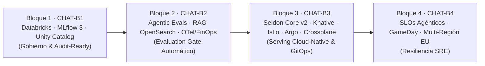

  Curso 2 · Enterprise MLOps &amp; Agentic Platform Engineering
  <h1>De Senior DevOps / SRE a Staff Agentic Platform Engineer</h1>
  
4 bloques (<code>CHAT-B1</code> a <code>CHAT-B4</code>) y 12 unidades ejecutadas en micro-sprints de 20 minutos para construir el proyecto integrador <code>agentic-platform-golden-path</code>: Databricks Mosaic AI, MLflow 3, Unity Catalog, Evals, RAG, Seldon/Knative/Istio/ArgoCD/Crossplane y SRE.

## Mapa de Dependencias (`agentic-platform-golden-path`)

## Sistema Operativo del Curso (Regla 1-a-1)

- **Baseline asumido:** Ya dominas Kubernetes, CI/CD, IaC AWS/Azure, gestión de secretos/IAM y Prometheus/Grafana. Aquí **no repites fundamentos DevOps**: cierras al 100 % las brechas específicas de plataformas agénticas en entornos regulados.
- **4 Chats Activos máximo:** un chat limpio por bloque (`CHAT-B1`..`CHAT-B4`), cerrando cada micro-sesión de 20 minutos con un bloque `HANDOVER:` YAML ([generador interactivo en Mi Progreso](../progreso.md)).

## Módulos del Curso 2

| Chat | Bloque | Entregables principales (`verify.sh < 60s`) | Enlace al Módulo |
| :--- | :--- | :--- | :--- |
| `CHAT-B1` | **B1 · Databricks, MLflow 3 y Unity Catalog** | `docs/adr/001-serving-topology.md`, pipeline `@dev->@champion`, `audit-evidence.json` | [Abrir Bloque 1 →](b1-databricks-mlflow-uc.md) |
| `CHAT-B2` | **B2 · Evals Agénticas, RAG y OTel/FinOps** | Arnés `mlflow.genai.evaluate()` (`15` casos), colector OpenSearch RAG, dashboard OTel/FinOps | [Abrir Bloque 2 →](b2-evals-rag-observabilidad.md) |
| `CHAT-B3` | **B3 · Seldon/Knative, Istio, ArgoCD y Crossplane** | Manifiestos Knative KPA + Istio Canary + `AnalysisTemplate` + XRD `XAgenticEnvironment` | [Abrir Bloque 3 →](b3-serving-gitops-crossplane.md) |
| `CHAT-B4` | **B4 · SLOs Agénticos, GameDay y Multi-Región** | Runbooks + simulacro *blameless* + ADR enrutamiento soberano UE | [Abrir Bloque 4 →](b4-sre-slos-multiregion.md) |

- **Manual PDF del Curso 2:** [Descargar `Curso_2_Agentic_Platform_MLOps.pdf`](../../pdf/Curso_2_Agentic_Platform_MLOps.pdf)
- **Playbook maestro original:** [Leer `01-agentic-mlops-playbook.md`](../../temario/01-agentic-mlops-playbook.md)
