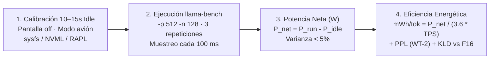

# Curso 3 · Módulos E0 y E1: Infraestructura, Telemetría `mWh/token` y Línea Base

[MOB] [LOC-PC] GTX 1050 [LOC-AND] Termux + sysfs [AGENT]

**Objetivo (`H0` + `H1`):** Compilar `llama.cpp` *upstream* (`b11556+`, Hadamard) y el fork `PrismML-llama.cpp` (`PTQ1_0`/`PQ2_0`) en PC y Android, calibrar un medidor físico fiable de **`mWh/token`**, y establecer el suelo (`TQ1_0` *naive*) y el techo real (`Bonsai 2 2B`) sobre `Qwen3.5-2B`.

---

## E0 · Compilación Dual y Telemetría Energética (`H0`)

### Sprints E0.1–E0.4 (`4 × 20 min`)

1. **E0.1 `[LOC-PC]`:** Crear `edge-ternary-lab`, compilar `llama.cpp` *upstream* con `-DCMAKE_CUDA_ARCHITECTURES=61` y `-DGGML_VULKAN=ON`, verificando que `llama-bench` detecta `CUDA0` y `Vulkan0`.
2. **E0.2 `[LOC-PC]`:** Compilar el fork `PrismML-llama.cpp` (rama `prism`) en directorio aparte para correr `PTQ1_0` y `PQ2_0` de Bonsai 2.
3. **E0.3 `[LOC-AND]`:** En Android (Termux de F-Droid), compilar `llama.cpp` con ARM64 NEON y probar compilación con Vulkan/ICD si `/dev/kgsl-3d0` o el driver Vulkan del SoC está expuesto en Termux.
4. **E0.4 `[AGENT]` + `[LOC-AND]`:** Calibrar `bench/measure_energy_pc.py` (`nvidia-smi`/NVML + `intel-rapl`) y `bench/measure_energy_and.sh` (`/sys/class/power_supply/battery/{current_now,voltage_now}`, auto-detectando $\mu\text{A}$ vs $\text{mA}$ y signo de descarga), validando un `--dry-run` determinista antes de generar `bench/results/test_h0.csv`.

$$
\text{TPS} = \frac{N}{t}, \qquad E_{\text{mWh}} = \frac{P_{\text{net}} \cdot t}{3.6}, \qquad \eta_E = \frac{P_{\text{net}}}{3.6 \cdot \text{TPS}}\quad [\text{mWh/token}]
$$

---

## E1 · Línea Base: `Qwen3.5-2B` vs. `Ternary Bonsai 2 2B` (`H1`)

### Sprints E1.1–E1.4 (`4 × 20 min`)

- **E1.1 `[LOC-PC]`:** Descargar `Qwen3.5-2B` (`F16` ~3.8 GB en CPU, `Q4_K_M` ~1.3 GB, `IQ2_XXS` ~0.75 GB, `TQ1_0` ~0.55 GB) y `Ternary-Bonsai-2-2B-gguf` (`Q2_0`, `PQ2_0`, `PTQ1_0`).
- **E1.2 `[LOC-PC]`:** Correr `llama-bench -p 512 -n 128 -ngl 99` en GTX 1050 (`CUDA` y `Vulkan`), anotando VRAM, `pp512`, `tg128` y `mWh/token`.
- **E1.3 `[LOC-AND]`:** Ejecutar los 4 modelos menores en Termux (CPU NEON vs Vulkan) registrando temperatura de batería, `tok/s` y `mWh/token`.
- **E1.4 `[LOC-PC]`:** Medir perplejidad (`PPL` en `wikitext-2-raw`) y divergencia KL (`llama-perplexity --kl-divergence-base` contra `F16`), documentando todo en `docs/02_bonsai_vs_qwen.md`.

### Techo Roofline en GTX 1050 y Coste en Bits Efectivos (`g128` vs `g32`)

$$
\text{TPS}_{\max} = \frac{\text{BW}_{\text{práctica}}}{\text{Bytes}_{\text{pesos}} + \text{Bytes}_{\text{KV/paso}}}, \qquad \text{bpp}_{\text{eff}} = b_{\text{peso}} + \frac{16}{g}
$$

---

## Ejercicios de E0 y E1 (`[MOB]`)

**Ejercicio E0-A (Energía neta en Android):** Tu móvil descarga a potencia neta $P_{\text{net}} = 4.2\text{ W}$ durante $t = 12.8\text{ s}$ generando $N = 256\text{ tokens}$. Calcula *throughput*, energía en julios y $\text{mWh}$, y eficiencia en $\text{mWh/token}$. Además, ¿por qué medir con pantalla apagada, modo avión y restando 15 s de *idle*?

??? success "Ver solución E0-A"
    - **Throughput:** $\text{TPS} = 256 / 12.8 = \mathbf{20.0\ \text{tok/s}}$.
    - **Energía total:** $E_{\text{J}} = 4.2 \times 12.8 = \mathbf{53.76\ \text{J}}$, que equivale a $E_{\text{mWh}} = 53.76 / 3.6 = \mathbf{14.933\ \text{mWh}}$.
    - **Eficiencia:** $14.933 / 256 = \mathbf{0.0583\ \text{mWh/token}}$ (equivalente a $\frac{4.2}{3.6 \times 20} = 58.3\ \mu\text{Wh/tok}$).
    - **Control de error sistemático:** la pantalla OLED/LCD consume `1.5–3.5 W` variables y los módems 4G/5G/Wi-Fi introducen picos impredecibles de transmisión que pueden igualar o enmascarar los `~4 W` del LLM; fijar modo avión, pantalla apagada (vía SSH/wakelock) y restar la línea base *idle* aísla el coste real de inferencia.

**Ejercicio E1-A (Roofline GTX 1050):** Con $\text{BW}_{\text{peak}} = 112\text{ GB/s}$ (eficiencia práctica $75\% \approx 84\text{ GB/s}$), calcula el techo `tok/s` en decode ($B=1$) para `Q4_K_M` (`1.30 GB`) frente a `PTQ1_0` (`0.45 GB`). Si `tg128` medido queda debajo del $60\%$ del techo, ¿qué 3 cuellos investigas?

??? success "Ver solución E1-A"
    - `Q4_K_M`: $\text{TPS}_{\max} \approx 84 / 1.30 \approx \mathbf{64.6\ \text{tok/s}}$.
    - `PTQ1_0`: $\text{TPS}_{\max} \approx 84 / 0.45 \approx \mathbf{186.7\ \text{tok/s}}$ (~**2.89×** más techo teórico solo por reducir tráfico de memoria).
    - Si quedas $< 60\%$ (`< 112 tok/s` en `PTQ1_0`): (1) sobrecarga de desempaquetado base-3 / escalas en registros (si usa divisiones/ramas o accesos no vectorizados), (2) latencia de lanzamiento de cientos de micro-kernels por capa en CPU/driver, o (3) coste de la transformada de Hadamard (`FHT`) antes de las proyecciones lineales.

**Ejercicio E1-B (Bits efectivos reales `g128` vs `g32`):** Calcula $\text{bpp}_{\text{eff}}$ con empaquetado base-3 (`1.6 bpp`, 5 pesos/byte) y con `TQ2_0` (`2.0 bpp`, 4 pesos/byte) más 1 escala FP16 (16 bits) por grupo para `g=128` y `g=32`. ¿Cuánto crece un modelo de `2B` parámetros al bajar de `g=128` a `g=32`?

??? success "Ver solución E1-B"
    - **Base-3 (`1.6 bpp`):**
      - `g=128`: $1.6 + 16/128 = \mathbf{1.725\ \text{bpp}}$ (o $1.75\text{ bpp}$ si alineas cada bloque a $\lceil 128/5 \rceil = 26\text{ B} + 2\text{ B} = 28\text{ B}$). En `2B` params $\approx \mathbf{431\text{ MB}}$ (`437.5 MB` alineado).
      - `g=32`: $1.6 + 16/32 = \mathbf{2.10\ \text{bpp}}$ (alineado a $7\text{ B}+2\text{ B}=9\text{ B}$ $\rightarrow 2.25\text{ bpp}$). En `2B` params $\approx \mathbf{525\text{ MB}}$ (`+94 MB`, **+21.7 %**).
    - **`TQ2_0` (`2.0 bpp`):**
      - `g=128`: $2.0 + 16/128 = \mathbf{2.125\ \text{bpp}}$ (`531 MB` en `2B`).
      - `g=32`: $2.0 + 16/32 = \mathbf{2.500\ \text{bpp}}$ (`625 MB`, `+94 MB` = **+17.6 %**).

### Fuentes Primarias
- `llama.cpp` upstream (`ggml-quants.c`, `ggml-vulkan`): `https://github.com/ggml-org/llama.cpp`
- PrismML Ternary Bonsai (`PrismML-llama.cpp`): `https://github.com/PrismML`
- Kernel Linux `power_supply` sysfs ABI: `https://www.kernel.org/doc/Documentation/ABI/testing/sysfs-class-power`
