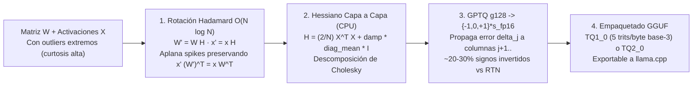

# Curso 3 · Módulo E2: Matemáticas y PTQ Sub-2-Bit (Base-3, Hadamard y GPTQ)

[MOB] [LOC-PC] CPU 16GB+ RAM [AGENT]

**Objetivo (`H2`):** Comprender e implementar en Python CPU capa a capa (`< 10 GB` RAM) las tres piezas matemáticas que evitan el colapso de calidad por debajo de 2 bits —*bit-packing* ternario, rotación ortogonal **Fast Hadamard Transform (`FHT`)** y compensación Hessiana **GPTQ**— replicando `Bonsai 2` sobre `Qwen3.5-2B`.

---

## E2.1–E2.6 · Anatomía del Pipeline Sub-2-Bit (`6 × 20 min`)

1. **E2.1 `[MOB]` (Packing + Invarianza):** Analizar `block_tq1_0` y `block_tq2_0` en `ggml-quants.c` junto con la identidad ortogonal $H H^T = I$.
2. **E2.2 `[MOB]` (OBQ/GPTQ):** Por qué redondear la columna $j$ introduce error $\delta_j$ que se compensa en columnas futuras usando $H^{-1} = (2 X^T X + \lambda I)^{-1}$.
3. **E2.3 `[LOC-PC]` (`llama-imatrix` baseline):** Cuantizar `Qwen3.5-2B-F16` a `TQ1_0`, `TQ2_0` e `IQ1_M` con matriz de importancia mixta (Wikipedia + Python/C++ + JSON tools) para medir cuánto mejora `KLD` antes de aplicar Hadamard.
4. **E2.4 `[AGENT]` + `[LOC-PC]` (`quant/hadamard.py`):** FHT vectorizada por bloques ($B \in \{128, 512, 1024\}$) con normalización $1/\sqrt{B}$ y tests verificando involución ($H(H(x)) \approx x$), preservación de producto escalar y caída de curtosis/*outliers*.
5. **E2.5 `[AGENT]` + `[LOC-PC]` (`quant/ternary_gptq.py`):** Carga *layer-by-layer* en CPU (`FP32`/`BF16`), 64–128 muestras de calibración, rotación Hadamard de $W$ y $X$, Cholesky de $H$ y cuantización `g128` con reporte de MSE, `%` de signos invertidos vs `RTN` y tiempo por capa.
6. **E2.6 `[LOC-PC]` (`quant/export_gguf.py`):** Verificar `PPL`/`KLD` simulado y exportado a GGUF frente al `Ternary Bonsai 2 2B` oficial.

---

## Ejercicios de E2 (`[MOB]`)

**Ejercicio E2-A (Empaquetado base-3 `TQ1_0` sin divisiones):** Con 5 trits $q_0 \dots q_4 \in \{0, 1, 2\}$ ($w_k = q_k - 1 \in \{-1, 0, +1\}$) y codificación MSB-first:

$$
b_{\text{base3}} = 81 q_0 + 27 q_1 + 9 q_2 + 3 q_3 + q_4 \in [0, 242]
$$

Codifica el vector $[-1, +1, 0, -1, +1]$ en un `uint8`, escálalo al rango `[0, 255]` y decodifica los 5 pesos usando únicamente multiplicación entera por `3` y desplazamiento `>> 8` (sin `% 3` ni `/ 3`).

??? success "Ver solución E2-A"
    1. **Codificación:** $[-1, +1, 0, -1, +1] \xrightarrow{+1} q = [0, 2, 1, 0, 2]$.
       - Valor base-3 puro: $b_{\text{base3}} = 81(0) + 27(2) + 9(1) + 3(0) + 2 = 54 + 9 + 2 = \mathbf{65}$ (en orden LSB-first sería `177`).
       - Escalado exacto estilo `llama.cpp`: $b_{\text{scaled}} = \lfloor (65 \times 256 + 242) / 243 \rfloor = \lfloor 16882 / 243 \rfloor = \mathbf{69}$.
    2. **Decodificación sin divisiones (bucle de 5 pasos con `xi = b_scaled`):**
       - Paso 0: `69 * 3 = 207` $\rightarrow$ `207 >> 8 = 0` ($w_0 = -1$), `xi = 207 & 0xFF = 207`.
       - Paso 1: `207 * 3 = 621` $\rightarrow$ `621 >> 8 = 2` ($w_1 = +1$), `xi = 621 & 0xFF = 109`.
       - Paso 2: `109 * 3 = 327` $\rightarrow$ `327 >> 8 = 1` ($w_2 = 0$), `xi = 327 & 0xFF = 71`.
       - Paso 3: `71 * 3 = 213` $\rightarrow$ `213 >> 8 = 0` ($w_3 = -1$), `xi = 213 & 0xFF = 213`.
       - Paso 4: `213 * 3 = 639` $\rightarrow$ `639 >> 8 = 2` ($w_4 = +1$).
       Se recuperan exactamente los 5 pesos con 0 instrucciones de división entera.

**Ejercicio E2-B (Invarianza y coste de Hadamard):** Demuestra en 3 líneas que si $H^T H = I$ y almacenas $\tilde{W} = W H$ y $\tilde{x} = x H$, entonces $\tilde{x} \tilde{W}^T = x W^T$. Compara el coste de aplicar FHT de tamaño $N=1024$ frente a una GEMV $1024 \times 1024$.

??? success "Ver solución E2-B"
    - **Demostración:**
      $$\tilde{x} \tilde{W}^T = (x H)(W H)^T = x (H H^T) W^T = x I W^T = x W^T$$
      (como $H$ es ortogonal y simétrica en Hadamard de Sylvester, $H = H^T = H^{-1}$ y $H H^T = I$).
    - **Coste operativo:** FHT para un vector de $N=1024$ realiza $N \log_2 N = 1024 \times 10 = \mathbf{10,240}$ sumas/restas (`10` pasadas de mariposas sobre registros/SMEM). La GEMV $1024 \times 1024$ ejecuta $2 \times 1024^2 = \mathbf{2,097,152}$ FLOPs/ops, es decir, la rotación FHT supone apenas el **~0.5 %** del coste aritmético y se amortiza en memoria compartida sin lecturas extra a DRAM.

**Ejercicio E2-C (Sign flips en GPTQ):** ¿Por qué en sub-2-bit (`{-s, 0, +s}`) entre un **20 % y un 30 %** de los pesos terminan con signo distinto al de *Round-to-Nearest* (`RTN`)?

??? success "Ver solución E2-C"
    Con solo 3 niveles discretos (`{-1, 0, +1}`), cuantizar un peso cercano a un umbral genera un error grande $\delta_j = w_j - \hat{w}_j$. GPTQ actualiza las columnas restantes proporcionalmente a $-\delta_j [H^{-1}]_{j, k>} / [H^{-1}]_{jj}$ según su correlación en $X^T X$; pesos originalmente pequeños cerca de $0$ o con signo opuesto cruzan el umbral de redondeo para cancelar el error acumulado de canales vecinos de mayor importancia.

### Fuentes Primarias
- Frantar et al. — *GPTQ: Accurate Post-Training Quantization for Generative Pre-trained Transformers*: `https://arxiv.org/abs/2210.17323`
- Ashkboos et al. — *QuaRot: Outlier-Free 4-Bit Inference in Rotated LLMs* (rotaciones Hadamard): `https://arxiv.org/abs/2404.00456`
- `llama.cpp` Ternary Quants (`block_tq1_0` / `block_tq2_0`): `https://github.com/ggml-org/llama.cpp/blob/master/ggml/src/ggml-quants.c`
