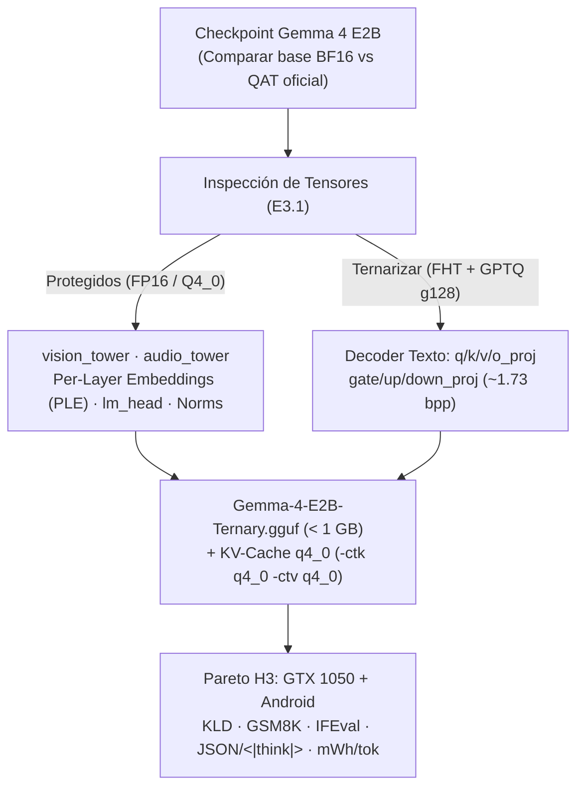

# Curso 3 · Módulo E3: Portabilidad a Gemma 4 E2B y Evaluación Real

[MOB] [LOC-PC] CPU + GTX 1050 [LOC-AND] Termux KV q4_0 [AGENT]

**Objetivo (`H3`):** Trasladar el pipeline Hadamard + GPTQ de `Qwen3.5-2B` a **`Gemma 4 E2B`**, respetando sus capas arquitectónicas críticas (*Per-Layer Embeddings*, torres multimodales y `lm_head`), empaquetar un modelo **`< 1 GB`**, y evaluarlo en la frontera de Pareto real (`KLD`, `GSM8K`, `IFEval`, JSON/`<|think|>`, `mWh/token`).

---

## E3.1–E3.5 · Mapa Anatómico y Evaluación Funcional (`5 × 20 min`)

1. **E3.1 `[MOB]` + `[LOC-PC]` (`docs/03_gemma4_anatomy.md`):** Inspeccionar `config.json` y los nombres de tensores en los checkpoints BF16 y QAT oficial de `Gemma 4 E2B`, separando *decoder* de texto, **Per-Layer Embeddings (PLE)**, `vision_tower`, `audio_tower` y `RMSNorm`/`QK-Norm`.
2. **E3.2 `[LOC-PC]`:** Configurar la lista blanca/negra en `quant/ternary_gptq.py`: ternarizar (`g128` + Hadamard) únicamente las proyecciones densas del *decoder* (`q/k/v/o_proj`, `gate/up/down_proj`) y proteger `PLE`, `vision_tower`, `audio_tower` y `lm_head` (`FP16`/`Q4_0`).
3. **E3.3 `[LOC-PC]`:** Ejecutar el PTQ comparando partir de `BF16` frente a partir del checkpoint `Gemma 4 QAT` oficial y exportar el GGUF ejecutable en `llama.cpp`.
4. **E3.4 `[AGENT]` + `[LOC-PC]`:** Correr mini-suite `lm-evaluation-harness` (200 muestras `GSM8K` + `IFEval` + batería propia de 30 prompts JSON/*Tool Calling* y modo `<|think|>`) frente a `Gemma-4-E2B-Q4_0` y `Bonsai 2 2B`.
5. **E3.5 `[LOC-AND]`:** Pasar `Gemma-4-E2B-Ternary` (`< 1 GB`) al móvil Android con KV-cache de 4 bits (`-ctk q4_0 -ctv q4_0`) y medir `tok/s`, RAM pico y `mWh/token`.

---

## Ejercicios de E3 (`[MOB]`)

**Ejercicio E3-A (Presupuesto de memoria en móvil):** Supón un modelo tipo `Gemma 4 E2B` con $2.0 \times 10^9$ parámetros en capas lineales del *decoder* comprimidos a $1.725\text{ bpp}$ y $0.45 \times 10^9$ parámetros combinados en embeddings / PLE / `lm_head` protegidos en `Q4_0` (`4.5 bpp`), más KV-Cache de `4096` tokens en `q4_0` (`0.5 B/elem` para $L=35, n_{\text{kv}}=2, d_{\text{head}}=256$, por ejemplo). Calcula el tamaño total y qué porcentaje consumen las capas protegidas.

??? success "Ver solución E3-A"
    - **Decoder ternario:** $2.0 \times 10^9 \times 1.725 / 8 \approx \mathbf{431.3\ \text{MB}}$ (`~411 MiB`).
    - **PLE + Embeddings + `lm_head` (`Q4_0`):** $0.45 \times 10^9 \times 4.5 / 8 \approx \mathbf{253.1\ \text{MB}}$ (si parte queda en `FP16`/`Q8_0`, sube a `300–400 MB`).
    - **KV-Cache `q4_0` (`4096` tokens):** $2 \times 35 \times 2 \times 256 \times 4096 \times 0.5\text{ B} \approx \mathbf{73.4\ \text{MB}}$ (`~70 MiB`).
    - **Peso total en RAM móvil:** $431 + 253 + 73 \approx \mathbf{757\ \text{MB}}$ (`< 1 GB` holgado!).
    - **Peso relativo de embeddings/PLE:** $253 / (431 + 253) \approx \mathbf{37\%}$ del archivo de pesos. Si intentas bajar `PLE`/`lm_head` a sub-2-bit para ahorrar esos `253 MB`, las filas del vocabulario y proyecciones por capa sufren error no compensable por contexto (*lookup* directo de índices) y la `KLD` se dispara colapsando el modelo.

**Ejercicio E3-B (Diagnóstico cuando `PPL` parece bien pero falla `IFEval` / bucles `<end_of_turn>`):** Enumera 3 causas raíz cuando la perplejidad solo sube `+1.2` pero el modelo rompe formato JSON, ignora instrucciones de `IFEval` o no emite `<end_of_turn>`, junto con la ablación rápida que confirma cada una.

??? success "Ver solución E3-B"
    1. **Degradación de `lm_head` o escala de logits:** la capa de salida amplifica errores pequeños hacia tokens de parada o llaves JSON (`}`, `<end_of_turn>`). *Ablación:* mantener `lm_head` en `Q8_0`/`FP16` y medir si desaparece el bucle.
    2. **Descalibración del conjunto de calibración (solo prosa WikiText-2):** si `X^T X` en `GPTQ` nunca vio sintaxis JSON, llamadas a tools ni delimitadores `<|think|>` / `<end_of_turn>`, los canales responsables de esas transiciones pierden fidelidad. *Ablación:* incluir 25–30 % de muestras de chat multi-turno, JSON y código en la calibración de `E2.3`/`E2.5`.
    3. **Outliers extremos en primera o última capa Transformer (`layers.0`, `layers.N-1`):** las capas frontera exhiben varianzas asimétricas que incluso la FHT por bloques pequeños no aplana del todo. *Ablación:* dejar primera y última capa en `Q4_0` (`4-bit`) mientras el cuerpo central sigue en ternario (`1.73 bpp`), midiendo la recuperación en `IFEval` frente a `< +30 MB` extra.

### Fuentes Primarias
- EleutherAI `lm-evaluation-harness`: `https://github.com/EleutherAI/lm-evaluation-harness`
- `llama.cpp` KV-Cache Quantization (`-ctk q4_0 -ctv q4_0`): `https://github.com/ggml-org/llama.cpp`
