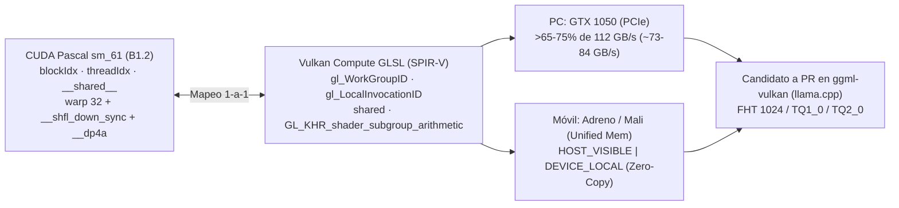

# Curso 3 · Módulo E4: Kernels Portables desde Cero (CUDA `sm_61` y Vulkan GLSL)

[MOB] [LOC-PC] nvcc + nsys + glslc [LOC-AND] Vulkan Zero-Copy [AGENT]

**Objetivo (`H4`):** Pasar de usuario de motores a **ingeniero de kernels portables**, implementando `GEMV` ternario `g128` y `FHT 1024` primero en CUDA Pascal (`sm_61` con **`__dp4a`**) y después en **Vulkan Compute (GLSL/SPIR-V)** ejecutando exactamente el mismo shader en la GTX 1050 y en la GPU Adreno/Mali de tu móvil.

---

## E4.1 · Diccionario Exacto CUDA $\leftrightarrow$ Vulkan Compute (GLSL)

| Concepto físico | CUDA C++ (`sm_61`) | Vulkan Compute (`GLSL 4.60` / SPIR-V) |
| :--- | :--- | :--- |
| **Índice de bloque / workgroup** | `blockIdx.{x,y,z}` | `gl_WorkGroupID.{x,y,z}` |
| **Índice local de hilo** | `threadIdx.{x,y,z}` | `gl_LocalInvocationID.{x,y,z}` |
| **Memoria compartida en chip** | `__shared__ float sdata[1024];` | `shared float sdata[1024];` |
| **Sincronización de bloque** | `__syncthreads();` | `barrier();` *(+ `memoryBarrierShared();`)* |
| **Reducción / Shuffle en subgrupo** | `__shfl_down_sync(mask, val, off)` | `subgroupAdd(val)` / `subgroupShuffleDown(val, off)` (`GL_KHR_shader_subgroup_arithmetic`, tamaño `gl_SubgroupSize` 32 o 64) |

---

## E4.2–E4.7 · Ruta de Ingeniería (`7 × 20 min`)

1. **E4.1 `[MOB]`:** Dominar el mapeo CUDA $\leftrightarrow$ Vulkan GLSL (y considerar `gl_SubgroupSize = 32` en NVIDIA/Adreno vs `64` o variable en Mali/AMD).
2. **E4.2 `[LOC-PC]` (`kernels/cuda_sm61/gemv_ternary.cu`):** Kernel `gemv_tq2_0_dp4a` donde **1 warp (32 hilos) calcula 1 fila de $W$** (4 pesos/hilo en bloques de `128`), con cargas coalescentes de 32/64 bits, desempaquetado *branchless* de 2-bit `{0->-1, 1->0, 2->+1}` a `int8x4`, instrucción **`__dp4a`** contra activaciones `Q8_1` (`int8` + escala FP16) y reducción `__shfl_down_sync`.
3. **E4.3 `[LOC-PC]`:** Perfilar con `nsys`, añadir cargas vectorizadas (`uint4` / 128-bit) y superar el **65–75 % del pico (`~73–84 GB/s` de `112 GB/s`)**.
4. **E4.4 `[LOC-PC]` (`kernels/cuda_sm61/fht.cu`):** FHT `512`/`1024` en *shared memory* sin *bank conflicts* (5 etapas iniciales en registros/warp-shuffles + 5 etapas finales en SMEM para $N=1024$).
5. **E4.5 `[AGENT]` + `[LOC-PC]`:** Portar a `kernels/vulkan_glsl/{gemv_ternary.comp, fht_1024.comp}` compilables con `glslc` a `.spv` + launcher C++ `kernels/bench_kernels.cpp` validado contra CPU FP32 en GTX 1050.
6. **E4.6 `[LOC-AND]`:** Ejecutar los mismos `.spv` en Android aprovechando memoria unificada (`VK_MEMORY_PROPERTY_HOST_VISIBLE_BIT | VK_MEMORY_PROPERTY_DEVICE_LOCAL_BIT`) sin copias PCIe H2D/D2H, midiendo `GB/s` y `mWh/op` frente a CPU ARM NEON.
7. **E4.7 `[LOC-PC]`:** Revisar *issues* abiertos de `ggml-vulkan` en `llama.cpp` (Hadamard de bloque grande 1024 o descuantización `TQ1_0`/`TQ2_0`) e integrar tu shader en una rama local.

---

## Ejercicios de E4 (`[MOB]`)

**Ejercicio E4-A (Ahorro de ALU con `__dp4a` en Pascal `sm_61`):** La GTX 1050 penaliza `FP16` nativo (1:64 respecto a `FP32`), pero ejecuta `__dp4a(int32_a, int32_b, int32_c)` (producto escalar de 4 enteros `int8` acumulado en `int32`) en **1 ciclo de instrucción**. Diseña el bucle para un bloque de `128` pesos ternarios contra activaciones `Q8_1` (`int8` + escala $s_x$) y calcula cuántas instrucciones de aritmética flotante ahorras por bloque.

??? success "Ver solución E4-A"
    - **Diseño por bloque de 128 elementos (`32` grupos de `4` pesos):**
      1. Cada hilo del warp carga 1 byte `TQ2_0` (4 pesos de 2 bits), extrae los 4 signos $\{-1, 0, +1\}$ de forma *branchless* (`(packed >> shift) & 3` menos `1`) y los empaqueta como `int8x4` dentro de un único `int32` (`w_i8x4`, vía `__byte_perm` o máscaras/shifts).
      2. Carga los 4 `int8` correspondientes de la activación `Q8_1` en otro `int32` (`x_i8x4`).
      3. Ejecuta **1 sola instrucción `__dp4a(w_i8x4, x_i8x4, acc_i32)`** por cada 4 elementos (**32 llamadas `__dp4a`** para todo el bloque de 128).
      4. Al terminar el bloque de 128, convierte `acc_i32` a `float` **una única vez** y multiplica por $(s_w \cdot s_x)$: `sum_f += float(acc_i32) * (sw * sx)`.
    - **Ahorro por bloque de 128:** frente a convertir 128 pesos + 128 activaciones a FP32 y hacer 128 FMAs (`~256+` ops de conversión + `128` FMA), ejecutas `32` instrucciones `__dp4a` + `2` FMAs de escala al final (**~8×–10× menos presión de ALU/registros**, permitiendo que el kernel quede limitado únicamente por los `112 GB/s` de GDDR5).

**Ejercicio E4-B (*Zero-copy* móvil y paralelismo con `LogFit`):** En PC discreto (PCIe), mover activaciones CPU $\leftrightarrow$ GPU cuesta microsegundos por transferencia. En un SoC móvil con memoria unificada, ¿cómo cambia el *buffer mapping* persistente (`HOST_VISIBLE | DEVICE_LOCAL`) el diseño de un *scheduler* híbrido CPU+GPU frente a `LogFit` (`oneTBB`)?

??? success "Ver solución E4-B"
    - En **PCIe discreto**, descargar un operador pequeño (p. ej. *router* MoE o *embeddings* dispersos) a CPU exige `D2H` + sincronización + `H2D`, devorando el ahorro.
    - En **memoria unificada móvil** con mapeo persistente Vulkan (`vkMapMemory` sobre heap `HOST_VISIBLE | DEVICE_LOCAL`), CPU ARM NEON y GPU Adreno/Mali comparten las **mismas páginas físicas** (basta una barrera de coherencia/caché sin copiar bytes).
    - Esto reproduce exactamente la filosofía de **`LogFit`** (donde CPU y GPU cooperaban sobre bloques particionados adaptativamente con `oneTBB`): ahora el *scheduler* puede asignar *embeddings*/PLE, muestreo de *logits* o *prefill* corto a CPU NEON mientras `ggml-vulkan` ejecuta las capas densas `GEMV` ternarias en GPU sin penalización PCIe.

### Fuentes Primarias
- Khronos Vulkan Compute & `GL_KHR_shader_subgroup`: `https://github.com/KhronosGroup/GLSL`
- NVIDIA CUDA PTX / `__dp4a` Intrinsic Docs: `https://docs.nvidia.com/cuda/cuda-math-api/`
- `llama.cpp` `ggml-vulkan` backend: `https://github.com/ggml-org/llama.cpp/tree/master/ggml/src/ggml-vulkan`
