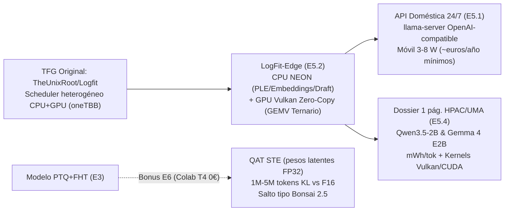

# Curso 3 · Módulos E5 y E6 (Bonus): Despliegue `< 8 W`, *LogFit-Edge*, Dossier UMA y QAT Ligero

[MOB] [LOC-PC] [LOC-AND] API 24/7 &lt; 8W [AGENT]

**Objetivo (`H5` + `H6`):** Convertir la investigación sub-2-bit en infraestructura doméstica útil (`< 8 W`, coste eléctrico mínimo), medir el reparto heterogéneo **LogFit-Edge** CPU+GPU, cerrar el puente histórico con `TheUnixRoot/Logfit` y redactar el dossier de 1 página para **Rafael Asenjo (HPAC/UMA)** — más el experimento bonus opcional `E6` (QAT `STE` + destilación KL).

---

## E5 · Ahorro Local (`< 8 W`), *LogFit-Edge* y Dossier HPAC/UMA (`4 × 20 min`)

- **E5.1 `[LOC-AND]` (`deploy/local_server.sh`):** Levantar `llama-server` con el modelo ganador (`Bonsai 2 2B` o `Gemma 4 E2B Ternary` + KV `q4_0`) como endpoint OpenAI en red local para resúmenes y asistente de terminal. Calcular consumo sostenido (W) y coste anual en `€/año` (`Potencia_kW × horas/año × tarifa_€/kWh`).
- **E5.2 `[LOC-PC]` + `[LOC-AND]` (Experimento *LogFit-Edge*):** Medir `tok/s` y `mWh/token` comparando 100 % GPU (`Vulkan`/`CUDA`) frente a reparto heterogéneo (embeddings/`PLE`/capas seleccionadas o *draft* en CPU NEON/`x86`, capas densas en GPU), encontrando la longitud de *prompt* donde se cruza la eficiencia CPU vs GPU.
- **E5.3 `[MOB]` + `[LOC-PC]` (`TheUnixRoot/Logfit`):** Actualizar el `README.md` de `Logfit` (3 párrafos explicando el trabajo original en `oneTBB`, contexto del TFG y enlace a `edge-ternary-lab` como evolución moderna sobre Vulkan/CUDA para LLMs).
- **E5.4 `[MOB]` (`docs/04_dossier_uma.md`):** Redactar un resumen ejecutivo de **exactamente 1 página**: problema (*bandwidth wall* + `mWh/token` en Edge AI), métricas reales medidas con `Qwen3.5-2B` y `Gemma 4 E2B`, y aportación propia en kernels portables Vulkan/CUDA.

---

## E6 (Bonus Opcional) · Recuperación QAT Mínima con STE + Destilación KL (`3 × 20 min`)

Solo tras completar `E3`, para comprobar empíricamente en GPU gratuita (**Colab / Kaggle T4 16 GB**) cómo PrismML cierra la brecha entre PTQ puro (`Bonsai 2`) y QAT agéntico (`Bonsai 2.5`):

- **E6.1 `[MOB]`:** Por qué los pesos latentes en QAT ternario deben permanecer en **FP32** (evitar *underflow* de actualizaciones pequeñas en Adam/Adafactor al cruzar umbrales de cuantización) y cómo vigilar el % de **code flips** (pesos que cambian entre `{-1, 0, +1}` por paso).
- **E6.2 `[AGENT]`:** Implementar `TernaryLinearG128` con *Straight-Through Estimator* (`STE`) y pérdida $D_{\text{KL}}(P_{\text{FP16}} \| P_{\text{QAT}})$ respecto al profesor congelado, corriendo `1M–5M` tokens sobre `Gemma 4 E2B` con Adafactor y *gradient checkpointing*.
- **E6.3 `[LOC-PC]`:** Medir antes vs. después la `KLD` y la tasa de éxito en JSON / *Tool Calling*.

---

## Ejercicios de E5 y E6 (`[MOB]`)

**Ejercicio E5-A (Factura eléctrica doméstica 24/7):** Compara mantener encendido todo el año (8,760 h) un servidor local en móvil (`5.5 W` medios en uso intermitente / `2.0 W` promedio 24h con picos de inferencia) frente a una torre PC antigua con GPU consumiendo `75 W` medios en reposo/uso, a `0.18 €/kWh`.

??? success "Ver solución E5-A"
    - **Móvil Android (`2.0 W` medios 24/7, `5–7 W` bajo inferencia):** $0.002\text{ kW} \times 8760\text{ h} = 17.52\text{ kWh/año} \times 0.18 = \mathbf{3.15\ \text{€/año}}$ (prácticamente cero, `< 0.30 €/mes`).
    - **PC antiguo (`75 W` medios):** $0.075\text{ kW} \times 8760\text{ h} = 657\text{ kWh/año} \times 0.18 = \mathbf{118.26\ \text{€/año}}$ (**~37× más caro** en electricidad que el nodo ARM/Vulkan móvil).

**Ejercicio E6-A (Por qué FP32 latente y STE en QAT ternario):** Si almacenas los pesos maestros en `BF16` durante QAT con *learning rate* $\eta = 10^{-4}$ y gradiente típico $\sim 10^{-2}$, ¿qué ocurre con las actualizaciones de peso y qué mide la tasa de *code flips*?

??? success "Ver solución E6-A"
    - En `BF16` (7 bits de mantisa, $\epsilon \approx 2^{-7} \approx 7.8 \times 10^{-3}$), para un peso $w = 0.5$ el menor incremento representable es $\sim 0.0039$. Un paso $\Delta w = \eta \cdot g \approx 10^{-6}$ se redondea a **cero exacto** (*underflow* estocástico), congelando el peso incapaz de cruzar la frontera del cuantizador ternario. Mantener los pesos latentes en `FP32` ($\epsilon \approx 1.19 \times 10^{-7}$) permite acumular miles de micro-pasos hasta cruzar el umbral.
    - La tasa de **code flips** mide el porcentaje de pesos cuyo símbolo ternario asignado cambia en cada paso de optimización: si es demasiado alta (`> 5%` tardío) el entrenamiento oscila sin estabilizar la rotación/escala; si cae a `0%` demasiado pronto el *learning rate* es insuficiente para corregir errores de `PTQ`.

### Fuentes Primarias
- Bengio et al. — *Estimating or Propagating Gradients Through Stochastic Neurons (STE)*: `https://arxiv.org/abs/1308.3432`
- `TheUnixRoot/Logfit` (referencia base TFG HPAC/UMA) & `llama-server` Docs: `https://github.com/ggml-org/llama.cpp/tree/master/tools/server`
