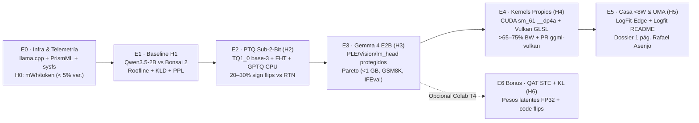

  Curso 3 · Edge-AI Sub-2-Bit &amp; Portable Kernels (B3-Edge)
  <h1>De Cuantización Sub-2-Bit a Kernels Portables CUDA / Vulkan</h1>
  
7 módulos (<code>E0</code>–<code>E6</code>) y 33 micro-sprints de 20 minutos a presupuesto <strong>0 €</strong> para replicar el rendimiento de <strong>Ternary Bonsai (PrismML)</strong> sobre <code>Qwen3.5-2B</code> → <code>Gemma 4 E2B</code>, programar kernels <code>GEMV</code> y <code>FHT</code> en CUDA <code>sm_61</code> y Vulkan Compute (GLSL), y desplegar inferencia doméstica <code>&lt; 8 W</code> + Dossier HPAC/UMA.

## Grafo de Módulos e Hitos (`edge-ternary-lab`)

## Hardware Disponible (0 € en Cloud)

| Dispositivo | Arquitectura / Cómputo | Memoria y Ancho de Banda | Rol en el Curso 3 |
| :--- | :--- | :--- | :--- |
| **PC Local (GPU)** `[LOC-PC]` | NVIDIA GTX 1050 (Pascal `sm_61`, 640 cores CUDA, `__dp4a`, sin Tensor Cores) | `2 GB` GDDR5 (`~112 GB/s`) | Profiling `nsys`, kernels `GEMV` ternario `sm_61` + Vulkan; inferencia completa 2B sub-2-bit (`< 1 GB` VRAM). |
| **PC Local (CPU)** `[LOC-PC]` | `x86_64` + RAM del sistema | `16 GB+` RAM | Calibración PTQ + rotación Hadamard + GPTQ capa a capa (`< 10 GB` RAM) en Python FP32/BF16. |
| **Móvil Android** `[LOC-AND]` | SoC ARM64 (`NEON`/`dotprod`) + GPU Adreno/Mali | Memoria unificada compartida | Medición real `sysfs` `mWh/token`, shaders Vulkan *zero-copy* y servidor OpenAI 24/7 (`3–8 W`). |
| **Bonus Opcional** (`E6`) | Google Colab / Kaggle `T4` gratuita | `16 GB` VRAM | Prueba QAT ligera (`1M–5M` tokens) con `STE` + destilación KL (salto tipo Bonsai 2.5). |

## Módulos del Curso 3 (`E0`–`E6`)

| Módulo | Foco principal | Sprints | Hito | Enlace al Módulo |
| :--- | :--- | :---: | :---: | :--- |
| **E0 + E1** | Infra `llama.cpp`/PrismML, telemetría `mWh/token` y baseline `Qwen3.5-2B` vs `Bonsai 2` | `4 + 4` | `H0`, `H1` | [Abrir E0–E1 (Infra & Baseline) →](e0-e1-infra-baseline.md) |
| **E2** | Bit-packing `TQ1_0`/`TQ2_0`, *Fast Hadamard Transform* (`FHT`) y `GPTQ` CPU `g128` | `6` | `H2` | [Abrir E2 (Matemáticas & PTQ) →](e2-ptq-hadamard-gptq.md) |
| **E3** | Anatomía `Gemma 4 E2B` (`PLE`, `lm_head`, KV `q4_0`), `GSM8K`/`IFEval`/`<|think|>` y Pareto | `5` | `H3` | [Abrir E3 (Gemma 4 & Evals) →](e3-gemma4-evals-pareto.md) |
| **E4** | Kernels desde cero: `gemv_tq2_0_dp4a` CUDA `sm_61` + `FHT 1024` + Vulkan GLSL/SPIR-V | `7` | `H4` | [Abrir E4 (Kernels CUDA & Vulkan) →](e4-kernels-cuda-vulkan.md) |
| **E5 + E6** | API `< 8 W` en casa, *LogFit-Edge* heterogéneo, Dossier UMA y Bonus QAT (`STE + KL`) | `4 + 3` | `H5`, `H6` | [Abrir E5–E6 (Edge Server, UMA & QAT) →](e5-e6-edge-server-logfit-qat.md) |

## Enganche con Curso 1 (`AI-infra-study`) sin Quemarte

1. **Durante Bloque 2 de Curso 1:** haz solo `E0` y `E1` en ratos sueltos (montar compilaciones y telemetría sin código complejo todavía).
2. **Al iniciar Bloque 3 (`B3.1` Cuantización) de Curso 1:** ejecuta `E2` y `E3` en paralelo a coste `0 €` antes de alquilar `Cloud-3` (`H100`).
3. **Al cerrar Bloque 3 de Curso 1:** construye `E4` (kernels CUDA `sm_61` + Vulkan) y `E5` (servidor doméstico + dossier para **Rafael Asenjo** en HPAC/UMA).

- **Manual PDF del Curso 3:** [Descargar `Curso_3_Edge_AI_Sub2Bit_Kernels.pdf`](../../pdf/Curso_3_Edge_AI_Sub2Bit_Kernels.pdf)
- **Playbook maestro completo:** [Leer `03-edge-ai-ternary-playbook.md`](../../temario/03-edge-ai-ternary-playbook.md)
- **Conexión con Cuantización Cloud (Curso 1 B3):** [Ver Bloque 3 de Curso 1 →](../curso1/b3-cuantizacion-pareto.md)
