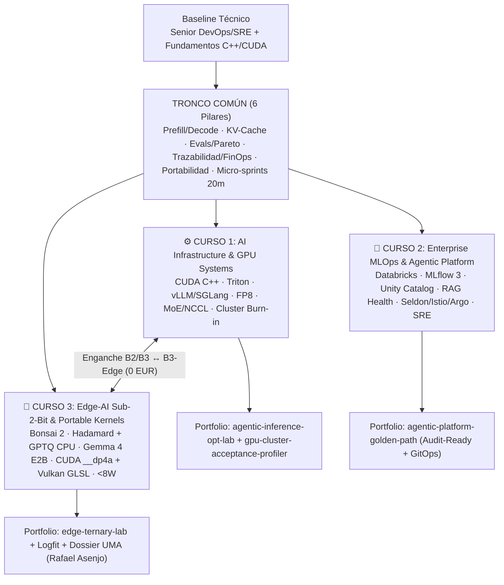

  Campus Virtual · AI Infra · Agentic MLOps · Edge-AI
  <h1>Arquitectura del Campus y Rutas de Estudio</h1>
  
Tres especializaciones técnicas diseñadas sobre un <strong>Tronco Común de 6 pilares</strong>, combinando micro-sprints de 20 minutos, laboratorios reproducibles en local/móvil y manuales PDF compilados en Typst.

## Mapa de Especialización del Campus

## Elige tu Itinerario o Sección

-   **🧭 Tronco Común (Empezar aquí)**

    ---

    Los **6 pilares transversales**, matriz de **lo común vs. lo específico** entre los 3 cursos y el Sistema Operativo de **20 minutos**.

    [Ir al Tronco Común →](tronco-comun.md)

-   **⚙️ Curso 1 · AI Infrastructure & GPU**

    ---

    5 bloques (`B1`–`B5`, 20 unidades): memoria HBM, CUDA C++, `nsys`/`ncu`, vLLM/SGLang, FP8, DeepSeek MoE, NCCL y K8s GPU.

    [Entrar al Curso 1 →](curso1/index.md)

-   **🤖 Curso 2 · Agentic Platform MLOps**

    ---

    4 bloques (`B1`–`B4`, 12 unidades): Databricks Mosaic AI, MLflow 3, Unity Catalog, evals agénticas, RAG, Seldon/Istio/Argo, Crossplane y SRE.

    [Entrar al Curso 2 →](curso2/index.md)

-   **📱 Curso 3 · Edge-AI Sub-2-Bit & Kernels**

    ---

    7 módulos (`E0`–`E6`, 33 sprints a `0 €`): `Qwen3.5-2B` → `Gemma 4 E2B`, Hadamard+GPTQ CPU, CUDA `sm_61` + Vulkan GLSL, `< 8 W` y Dossier UMA.

    [Entrar al Curso 3 →](curso3/index.md)

-   **📚 Biblioteca PDF & Progreso**

    ---

    Descarga los manuales de nivel Máster en **PDF** (y código fuente Typst), marca unidades completadas en los 3 cursos y genera bloques **Handover**.

    [Biblioteca PDF](biblioteca-pdf.md) · [Mi Progreso](progreso.md)

## Convenciones de Ejecución y Hardware

!!! warning "Reglas de Oro del Laboratorio ([`AGENTS.md`](../../AGENTS.md))"
    - **Hardware local de referencia:** **NVIDIA GTX 1050 (Pascal `sm_61`, 2 GB VRAM)** + PC CPU (`16 GB+` RAM) + móvil Android (`ARM64 NEON` + Vulkan). En Curso 1 todo experimento local usa tensores `< 256 MB`; en Curso 3 los modelos 2B sub-2-bit (`< 1 GB`) caben enteros en VRAM local (`0 €`).
    - **Sin Triton / FP8 / multi-GPU en Pascal:** las prácticas datacenter de Curso 1 siguen el protocolo `[PREP]` (código y tests listos a `0 EUR` en local) antes de alquilar GPU `[CLD]` (`L4`, `L40S`, `H100`).
    - **Auto-kill obligatorio en Cloud:** lo primero al arrancar cualquier VM de GPU en cloud es `sudo shutdown -h +90`.
    - **Cero cifras inventadas:** todas las métricas de [Informe de Resultados](../../INFORME_RESULTADOS.md) salen de ejecuciones reales guardadas en `artifacts/`.

## Modalidades de Micro-Sprint (20 minutos)

| Etiqueta | Significado | Entorno | Qué haces en 20 min |
| :--- | :--- | :--- | :--- |
| [MOB] | Lectura y diseño | Móvil / tablet | Docs oficiales, ADRs, matemáticas en papel (Roofline, KV, base-3, Hadamard) |
| [LOC] | Laboratorio local | GTX 1050 / Docker / Kind / CPU | Scripts `run.sh`, CUDA `nvcc`, `kv_calc.py`, MLflow/OpenSearch local |
| [LOC-PC] | PC local (Curso 3) | CPU 16GB+ RAM / GTX 1050 `sm_61` | PTQ+Hadamard+GPTQ en CPU, `llama-bench`, `nsys` en `gemv_ternary.cu` y Vulkan |
| [LOC-AND] | Móvil Android (Curso 3) | Termux ARM64 NEON + Vulkan + `sysfs` | Telemetría `mWh/token`, shaders Vulkan *zero-copy* y servidor local `< 8 W` |
| [AGENT] | Delegación controlada | Agente de código + tests obligatorios | Boilerplate de medición, harness `hadamard`/`gptq` o portado GLSL vía Pre-Flight |
| [PREP] | Pre-Flight sin GPU | Portátil / CI offline | Dejar arnés, métricas Prometheus y tests listos antes de alquilar cloud |
| [CLD] | Ráfaga GPU Cloud | L4 / L40S / 2–8×H100 | Ejecutar benchmarking ya preparado (`ncu`, `vLLM`, FP8, `nccl-tests`) |
| [LAB] | Sandbox 0 € | Databricks Free/Trial · Colab T4 (E6) | Unity Catalog / MLflow Registry (`C2`) o experimento bonus QAT STE+KL (`C3-E6`) |
