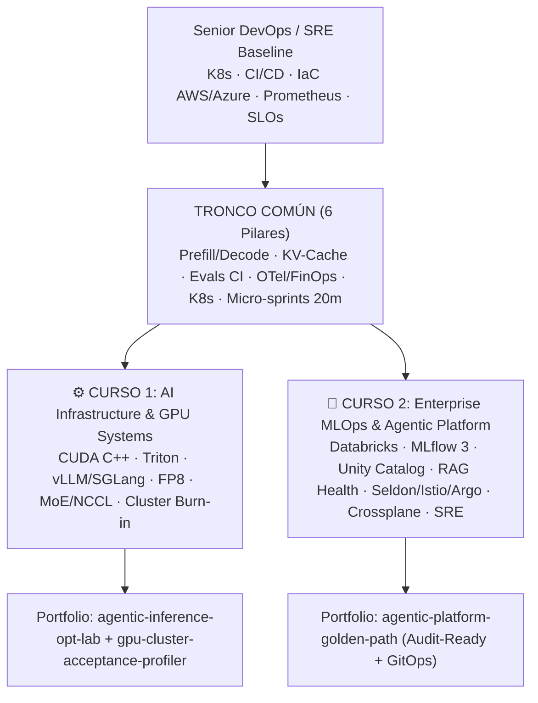

  Campus Virtual · AI Infra &amp; Agentic MLOps
  <h1>Arquitectura del Campus y Rutas de Estudio</h1>
  
Dos especializaciones técnicas diseñadas a partir de un perfil <strong>Senior DevOps / SRE</strong> sobre un Tronco Común de 6 pilares, combinando micro-sprints de 20 minutos, laboratorios reproducibles en local y manuales PDF compilados en Typst.

## Mapa de Especialización del Campus

## Elige tu Itinerario o Sección

-   **🧭 Tronco Común (Empezar aquí)**

    ---

    Los **6 pilares transversales** y el Sistema Operativo de estudio de **20 minutos** (`[MOB]`, `[LOC]`, `[PREP]`, `[CLD]`, `[LAB]`).

    [Ir al Tronco Común →](tronco-comun.md)

-   **⚙️ Curso 1 · AI Infrastructure & GPU**

    ---

    5 bloques (`B1`–`B5`, 20 unidades): memoria HBM, CUDA C++, `nsys`/`ncu`, vLLM/SGLang, FP8, DeepSeek MoE, NCCL y K8s GPU.

    [Entrar al Curso 1 →](curso1/index.md)

-   **🤖 Curso 2 · Agentic Platform MLOps**

    ---

    4 bloques (`B1`–`B4`, 12 unidades): Databricks Mosaic AI, MLflow 3, Unity Catalog, evals agénticas, RAG, Seldon/Istio/Argo, Crossplane y SRE.

    [Entrar al Curso 2 →](curso2/index.md)

-   **📚 Biblioteca PDF & Progreso**

    ---

    Descarga los manuales de nivel Máster en **PDF** (y código fuente Typst), marca unidades completadas y genera bloques **Handover**.

    [Biblioteca PDF](biblioteca-pdf.md) · [Mi Progreso](progreso.md)

## Convenciones de Ejecución y Hardware

!!! warning "Reglas de Oro del Laboratorio ([`AGENTS.md`](../../AGENTS.md))"
    - **Hardware local de referencia:** **NVIDIA GTX 1050 (Pascal `sm_61`, 2 GB VRAM)**. Todo experimento local usa tensores `< 256 MB` (`2048x2048 FP32 = 16 MiB`) para evitar OOM.
    - **Sin Triton / FP8 / multi-GPU en Pascal:** esas prácticas siguen el protocolo `[PREP]` (código y tests listos a `0 EUR` en local) antes de alquilar GPU `[CLD]` (`L4`, `L40S`, `H100`).
    - **Auto-kill obligatorio en Cloud:** lo primero al arrancar cualquier VM de GPU en cloud es `sudo shutdown -h +90`.
    - **Cero cifras inventadas:** todas las métricas de [Informe de Resultados](../../INFORME_RESULTADOS.md) salen de ejecuciones reales guardadas en `artifacts/`.

## Modalidades de Micro-Sprint (20 minutos)

| Etiqueta | Significado | Entorno | Qué haces en 20 min |
| :--- | :--- | :--- | :--- |
| [MOB] | Lectura y diseño | Móvil / tablet | Docs oficiales, ADRs, cálculo mental Roofline/KV y preguntas de validación |
| [LOC] | Laboratorio local | GTX 1050 / Docker / Kind / CPU | Scripts `run.sh`, CUDA `nvcc`, `kv_calc.py`, MLflow/OpenSearch local |
| [PREP] | Pre-Flight sin GPU | Portátil / CI offline | Dejar arnés, métricas Prometheus y tests listos antes de alquilar cloud |
| [CLD] | Ráfaga GPU Cloud | L4 / L40S / 2–8×H100 | Ejecutar benchmarking ya preparado (`ncu`, `vLLM`, FP8, `nccl-tests`) |
| [LAB] | Sandbox 0 € | Databricks Free/Trial | Validar Unity Catalog, MLflow Model Registry y Mosaic AI Agent Framework |
