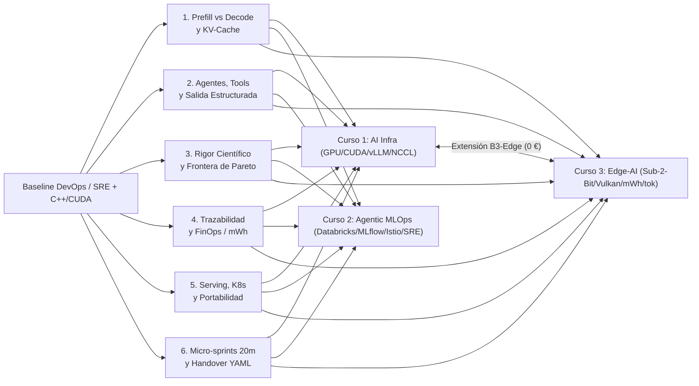

# Tronco Común: Lo Común, Lo Específico y Sistema Operativo

Partiendo de un perfil **Senior DevOps / SRE** (Kubernetes, CI/CD, IaC en AWS/Azure, gestión de secretos/identidades, SLOs, Prometheus/Grafana) más base en sistemas C++/CUDA (`LogFit` + `B1.1`–`B2.1`), los **tres cursos** comparten ~35–40 % de fundamentos invariantes (**Tronco Común de 6 Pilares**) y divergen con precisión en sus especializaciones: **Datacenter GPU** (Curso 1), **Enterprise Agentic Platform** (Curso 2) y **Edge-AI Sub-2-Bit & Portable Kernels** (Curso 3).

## Arquitectura Unificada de los Tres Cursos



---

## Los 6 Pilares del Tronco Común (Lo Común)

| Pilar Común | Núcleo invariante | Aplicación en Curso 1 (AI Infra) | Aplicación en Curso 2 (Agentic MLOps) | Aplicación en Curso 3 (Edge-AI Sub-2-Bit) |
| :--- | :--- | :--- | :--- | :--- |
| **1. Física Prefill/Decode & KV-Cache** | Prefill *compute-bound* vs Decode *bandwidth-bound* ($I \approx 1 \ll I^*$) y KV lineal ($2 \cdot L \cdot n_{\text{kv}} \cdot d_{\text{head}} \cdot S \cdot B \cdot b$). | Ecuación Roofline en H100/GTX 1050, `kv_calc.py`, KV-Cache FP8, MLA y PagedAttention. | *Capacity planning* (`TPM`/`RPM` vs VRAM), dimensionamiento de endpoints y latencia cross-region. | Techo $\text{TPS}_{\max} = \text{BW} / \text{Bytes}$ en `112 GB/s` y móvil; compresión sub-2-bit (`1.73 bpp`) + KV `q4_0` (`< 1 GB`). |
| **2. Cargas Agénticas, Tools y Calidad Real** | Prompts estructurados, invocación de herramientas JSON y trazas `<|think|>` donde la perplejidad no basta. | *Prefix Caching* (`APC`/`RadixAttention`) y gramáticas FSM (`XGrammar`) a alta concurrencia. | Evaluación de trayectorias (`Task Success`, `Tool Reliability`), salud RAG (`Recall@K`, `index_lag`). | Evaluación `GSM8K`, `IFEval`, JSON/*Tool Calling*, `<|think|>` y diagnóstico de fallos (`lm_head`, `PLE`, `<end_of_turn>`). |
| **3. Rigor Científico y Frontera de Pareto** | Warmup obligatorio, percentiles/varianza (`< 5 %`), cero cifras inventadas y optimización multi-objetivo. | `p50`/`p95`/`p99` sin *coordinated omission*; Pareto `TPOT` vs `tok/s` vs `$/1M` vs calidad. | `mlflow.genai.evaluate()` bloqueando promociones `@staging` $\rightarrow$ `@champion`; *Canary Auto-Rollback*. | Muestreo físico `sysfs`/`NVML` con línea base *idle* (pantalla off/modo avión) y Pareto `MB` + `mWh/tok` vs `KLD`/calidad. |
| **4. Trazabilidad End-to-End y Economía** | Medición causal sin cajas negras del cuello de botella y del coste real por token. | `nsys` + NVTX, `ncu` roofline, `perf` y coste `$/1M tokens` en L40S/H100. | OpenTelemetry GenAI (`spans`), MLflow Tracing, OpenSearch y *circuit breakers* FinOps. | `nsys` sobre `GEMV` ternario `sm_61` (`> 65–75 %` pico), `perf`, potencia neta (W), `mWh/token` y coste eléctrico `€/año`. |
| **5. Ejecución, Serving y Portabilidad** | Llevar la inferencia a producción estable adaptada a las restricciones del entorno. | GPU Operator K8s, `MIG` vs *Time-Slicing*, `LWS`, `PDD`/`NIXL` y *cold starts* 70B. | Seldon Core v2, Knative KPA por concurrencia, Istio canary/shadow, Crossplane XRDs y SRE UE. | Kernels portables **CUDA `sm_61` $\leftrightarrow$ Vulkan Compute GLSL** (*zero-copy* móvil), *LogFit-Edge* CPU+GPU y `llama-server < 8 W`. |
| **6. Sistema Operativo 20m y Delegación** | Micro-sprints de 20 min, *Handover* YAML y delegación de boilerplate con tests obligatorios. | Regla 1-a-1 `CHAT-B1..B5`, `[PREP]` $\rightarrow$ `[CLD]`, `run.sh --smoke-test`, `sudo shutdown -h +90`. | Regla 1-a-1 `CHAT-B1..B4`, `[MOB]`/`[LOC]`/`[LAB]`, `verify.sh < 60s` y `audit-evidence.json`. | Regla de no bloqueo `[MOB]`/`[LOC-PC]`/`[LOC-AND]`/`[AGENT]`, Prompts Pre-Flight, tests unitarios y 1 commit por sprint. |

---

## Lo Específico: Fronteras Claras entre Itinerarios

- **Específico de Curso 1 (`AI Infra Datacenter`):** Programación moderna con **OpenAI Triton** y **Nsight Compute (`ncu`)**, motores de alto *throughput* (`vLLM V1`, `SGLang`, `TensorRT-LLM`, `NVIDIA Dynamo`), precisión Tensor Core (`FP8`, `AWQ`, `NVFP4`), *Speculative Decoding* (`EAGLE-3`, `MTP`), paralelismo multi-GPU (`TP`/`PP`/`EP`, `MoE`, `NCCL`, `PDD`) y aceptación física de clústeres (`dcgmi`, `Xid`, `Megatron MFU`).
- **Específico de Curso 2 (`Enterprise Agentic MLOps`):** Gobernanza regulada en **Databricks Mosaic AI**, **MLflow 3** (`LoggedModel` + aliases), **Unity Catalog** (`lineage`, `RBAC`/`ABAC`, `audit-evidence.json`), observabilidad RAG/OTel, *GitOps* en Kubernetes (**Seldon**, **Knative**, **Istio**, **ArgoCD**, **Crossplane**) y operación SRE multi-región UE con soberanía RGPD.
- **Específico de Curso 3 (`Edge-AI Sub-2-Bit & Kernels Portables`):**
  1. **Cuantización extrema sub-2-bit (`1.725–2.125 bpp`) a coste 0 €:** empaquetado base-3 `TQ1_0` sin divisiones (`(xi * 3) >> 8`), rotación ortogonal *Fast Hadamard Transform* (`FHT`) para aplastar *outliers*, `GPTQ` con inversa Hessiana capa a capa en CPU (`< 10 GB` RAM) y protección selectiva de `PLE`/`vision_tower`/`audio_tower`/`lm_head` en `Gemma 4 E2B`.
  2. **Ingeniería de kernels portables sin *vendor lock-in*:** aritmética entera **`__dp4a` (`int8x4` vs `Q8_1`)** en Pascal `sm_61`, `FHT 1024` en *shared memory* + *subgroups*, y portado idéntico a **Vulkan Compute (`GLSL 4.60` / SPIR-V)** validado tanto en GTX 1050 como en GPU móvil Adreno/Mali *zero-copy* (`HOST_VISIBLE | DEVICE_LOCAL`), candidato a PR en `ggml-vulkan` (`llama.cpp`).
  3. **Producto tangible y puente académico (`LogFit` $\rightarrow$ HPAC/UMA):** servidor doméstico 24/7 `< 8 W`, experimento heterogéneo CPU+GPU *LogFit-Edge* y dossier técnico de 1 página para **Rafael Asenjo**.

### Enganche Temporal Sin Quemarte (Curso 1 $\leftrightarrow$ Curso 3)

1. **Bloque 2 de Curso 1 (`B2.1`–`B2.4`):** avanza en paralelo `E0` y `E1` en ratos sueltos (compilar `llama.cpp`/PrismML + telemetría `mWh/token`).
2. **Bloque 3 de Curso 1 (`B3.1`–`B3.4`):** ejecuta `E2` y `E3` en CPU local (`0 €`) antes de alquilar GPU `H100` para `Cloud-3`.
3. **Tras cerrar Bloque 3 de Curso 1:** dedica los sprints finales a `E4` (kernels CUDA `sm_61` + Vulkan) y `E5` (servidor `< 8 W` + dossier UMA).

---

## Sistema Operativo de Micro-Sprints (20 min)

1. **Regla de foco y no bloqueo:** un único chat por bloque/módulo; si una tarea de *boilerplate* supera 20 minutos, delega al Agente de Código mediante el Prompt Pre-Flight con tests unitarios obligatorios y cierra cada sesión con `HANDOVER:` YAML.
2. **Documento completo:** consulta [`02-tronco-comun-y-itinerarios.md`](../temario/02-tronco-comun-y-itinerarios.md) o descarga los manuales en [Biblioteca PDF](biblioteca-pdf.md).

### Plantillas Listas para Copiar

=== "A. Inicio / Fork de Chat `[FORK]`"

    ```text
    [FORK CHAT]
    Contexto: Lee el Master Playbook correspondiente en docs/temario/.
    Curso: [Curso 1 - AI Infra / Curso 2 - Agentic MLOps / Curso 3 - Edge-AI Sub-2-Bit]
    Bloque/Módulo activo: [Bx / Ex] | Unidad/Sprint actual: [Bx.y / Ex.y]
    Estado previo (Handover): <pegar último bloque HANDOVER o "Inicio">
    Tiempo disponible ahora: 20 minutos | Modo: [MOB / LOC / LOC-PC / LOC-AND / AGENT / PREP / CLD / LAB]
    Objetivo de este micro-sprint: <ej. calibrar sysfs mWh/tok / validar KV-Cache>
    Regla: Respuestas concisas, legibles en móvil, sin relleno. Al final dame el bloque HANDOVER actualizado.
    ```

=== "B. Cierre de Sesión (`HANDOVER` YAML)"

    ```yaml
    HANDOVER:
      itinerario: "Curso 1 (AI Infra) | Curso 2 (Agentic MLOps) | Curso 3 (Edge-AI)"
      unidad_actual: "E0.4"
      estado: "en_progreso" # pendiente | en_progreso | done
      aprendido_o_verificado:
        - "Invariante o métrica verificada con evidencia real"
      artefacto_generado: "ruta/al/script_o_doc"
      bloqueos_o_dudas: "Detalle concreto pendiente"
      siguiente_micro_sprint_20m: "Ex.y [MODO] - Siguiente paso exacto"
    ```

=== "C. Delegación al Agente de Código"

    ```text
    Actúa como Staff AI Infra / Kernel Engineer. Vamos a construir el entregable para [Bx.y / Ex.y].
    Stack objetivo: [CUDA sm_61 / Vulkan GLSL / PyTorch CPU / llama.cpp / vLLM / MLflow / K8s].
    Requisitos:
    1. Código declarativo, reproducible y versionable en Git.
    2. Script de validación `verify.sh` / `run.sh --smoke-test` / `--dry-run` (<60s) con tests unitarios obligatorios.
    3. Evidencias estructuradas (JSON/CSV/Markdown) reales sin cifras simuladas.
    ```

[Generar Handover Interactivo y Marcar Progreso →](progreso.md)
