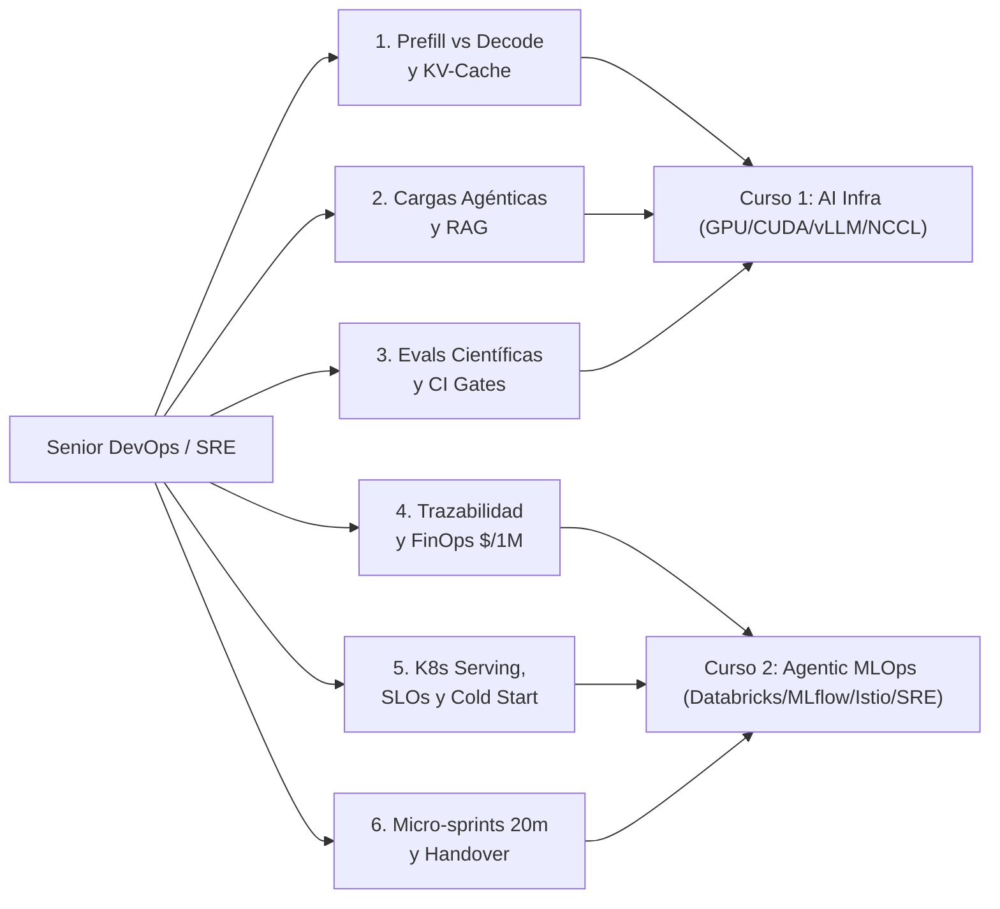

# Tronco Común y Sistema Operativo de Estudio

Partiendo de un perfil **Senior DevOps / SRE** (Kubernetes, CI/CD, IaC en AWS/Azure, gestión de secretos e identidades, SLOs, respuesta a incidentes y Prometheus/Grafana), ambos cursos omiten los fundamentos básicos de infraestructura generalista y concentran el tiempo en **cerrar brechas específicas de IA en producción**.

## Arquitectura Unificada de Ambos Cursos



---

## Los 6 Pilares del Tronco Común

| Pilar | Núcleo técnico | Cómo se aplica en Curso 1 (AI Infra) | Cómo se aplica en Curso 2 (Agentic MLOps) |
| :--- | :--- | :--- | :--- |
| **1. Física Prefill vs Decode y KV-Cache** | Prefill (*compute-bound*) frente a Decode (*memory-bandwidth-bound*) y crecimiento lineal del KV-Cache ($2 \cdot L \cdot n_{\text{kv}} \cdot d_{\text{head}} \cdot S \cdot B \cdot b$). | Ecuación Roofline, calculadora `kv_calc.py`, cuantización KV a FP8, MLA y PagedAttention. | *Capacity planning* (`TPM`/`RPM` vs VRAM), dimensionamiento de endpoints y latencia cross-region. |
| **2. Anatomía Agéntica y RAG** | Prefijos de sistema + definiciones de 10–30 *tools* (3k–6k tokens compartidos), salida JSON estructurada y bucle de invocación de herramientas. | *Prefix Caching* (`APC` / `RadixAttention`), enmascaramiento gramatical (`XGrammar`) y routing *cache-aware*. | Separación de fallos *Retrieval* (`Recall@K`, `index_lag`) vs *Generation* (`faithfulness`), OpenSearch y chunking. |
| **3. Rigor Científico y Gates en CI** | Nada pasa sin comparación cuantitativa reproducible, warmup y control de regresiones. | Percentiles `p50`/`p95`/`p99` bajo carga abierta (sin *coordinated omission*) y frontera de Pareto. | `mlflow.genai.evaluate()` bloqueando promociones `@staging` $\rightarrow$ `@champion` si caen calidad o fiabilidad de tools. |
| **4. Trazabilidad End-to-End y FinOps** | Correlación causal de latencia y coste por token/petición sin cajas negras. | Trazas `nsys` + NVTX (H2D vs kernel), perfilado `ncu` y métrica `USD / 1M tokens`. | OpenTelemetry GenAI (`span` LLM / Retrieval / Tool), detección de bucles FinOps y *circuit breakers* por tenant. |
| **5. Serving en K8s y Operación SRE** | Escalar servicios de IA por concurrencia/cola KV y proteger disponibilidad con presupuestos de error. | `MIG`, *time-slicing*, tiempos de *cold start* de pesos grandes y aceptación GPU con DCGM/`Xid`. | Seldon Core v2, Knative KPA por concurrencia, Istio canary/shadow + Argo Rollouts, Crossplane XRDs y SLOs. |
| **6. Sistema Operativo de Estudio (20m)** | Avance modular auditable en micro-sesiones sin saturar contexto. | Protocolo `[PREP]` $\rightarrow$ `[CLD]` con `run.sh --smoke-test` (< 30 s) y artefactos JSON reales. | Regla 1-a-1 (`CHAT-B1`..`CHAT-B4`), bloques `HANDOVER` YAML y `verify.sh` (< 60 s). |

---

## Sistema Operativo de Micro-Sprints (20 min)

1. **Regla 1-a-1:** máximo **1 chat activo por bloque** para evitar contaminación de contexto. Cuando un chat crece o termina una sesión de 20 minutos, se emite un bloque `HANDOVER:` y se continúa en limpio con un `[FORK]`.
2. **Separación de roles:** el LLM tutor revisa arquitectura/ADRs y rúbricas; el Agente de Código genera pipelines, scripts `run.sh`/`verify.sh` y tests automatizados; tú ejecutas y validas evidencias.
3. **Documento completo:** consulta también [`02-tronco-comun-y-itinerarios.md`](../temario/02-tronco-comun-y-itinerarios.md) o descarga el capítulo compilado en [Biblioteca PDF](biblioteca-pdf.md).

### Plantillas Listas para Copiar

=== "A. Inicio / Fork de Chat `[FORK]`"

    ```text
    [FORK CHAT-Bx]
    Contexto: Lee el Master Playbook en docs/temario/.
    Curso: [Curso 1 - AI Infra / Curso 2 - Agentic MLOps]
    Bloque activo: [Bx] | Unidad actual: [Bx.y]
    Estado previo (Handover): <pegar último bloque HANDOVER o "Inicio de bloque">
    Tiempo disponible ahora: 20 minutos | Modo: [MOB / LOC / PREP / CLD / LAB]
    Objetivo de este micro-sprint: <ej. estudiar Unity Catalog lineage / validar KV-Cache>
    Regla: Respuestas concisas, legibles en móvil, sin relleno. Al final dame el bloque HANDOVER actualizado.
    ```

=== "B. Cierre de Sesión (`HANDOVER` YAML)"

    ```yaml
    HANDOVER:
      unidad_actual: "B1.1"
      estado: "en_progreso" # pendiente | en_progreso | done
      aprendido_o_verificado:
        - "Diferencia entre Databricks Mosaic AI Serverless y Seldon en K8s"
      artefacto_generado: "docs/adr/001-serving-topology.md"
      bloqueos_o_dudas: "Pendiente validar permisos de linaje en Unity Catalog"
      siguiente_micro_sprint_20m: "B1.2 [LOC] - Configurar MLflow Tracking + Evaluation Gate local"
    ```

=== "C. Delegación al Agente de Código"

    ```text
    Actúa como Staff MLOps & AI Infrastructure Engineer. Vamos a construir el entregable para [Bx.y].
    Stack objetivo: [CUDA / PyTorch / vLLM / MLflow / Kind / ArgoCD / Seldon / Istio / OpenTelemetry].
    Requisitos:
    1. Código declarativo, reproducible y versionable en Git.
    2. Script de validación `verify.sh` o `run.sh --smoke-test` (<60s) con salida clara por stdout.
    3. Evidencias estructuradas (JSON/Markdown) reales en artifacts/ sin cifras simuladas.
    ```

[Generar Handover Interactivo y Marcar Progreso →](progreso.md)
